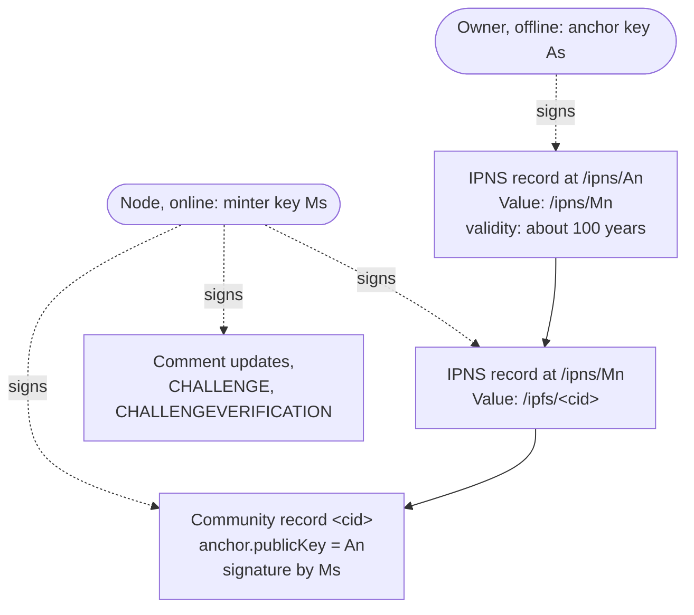

## Abstract

A **delegated community** separates the key that identifies it from the key that publishes it. The
owner holds the **anchor** key offline; its key address is the community's identity. An online node
holds a **minter** key and signs the community record, its comment updates, and its challenge
messages. The owner signs one long-lived IPNS record that points the anchor's IPNS name at the
minter's; the minter's IPNS record points at the current community record, which carries a signed
`anchor` claim naming its identity. This BSIP specifies that chain, the `anchor` field, the exact
algorithm a reader uses to load and verify a community record (ordinary or delegated) and the
comment updates signed under delegation, how a delegated community's name must be configured, and
how the owner sets up and rotates minters.

## Motivation

A community's record must be re-signed every time its content changes, so the signing key has to
live on an always-online machine. If that key is also the community's identity, then whoever runs
the machine, a hosting provider or an RPC operator, can take the community over permanently, and a
leaked key loses the address for good. Delegation lets the owner keep the identity key offline,
hand day-to-day publishing to a replaceable delegate, and revoke that delegate by signing one new
record, without changing the community's address or invalidating any content it has published.

## Specification

The key words "MUST", "MUST NOT", "REQUIRED", "SHALL", "SHALL NOT", "SHOULD", "SHOULD NOT",
"RECOMMENDED", "NOT RECOMMENDED", "MAY", and "OPTIONAL" in this document are to be interpreted as
described in [RFC 2119](https://www.rfc-editor.org/rfc/rfc2119) and
[RFC 8174](https://www.rfc-editor.org/rfc/rfc8174).

### Keys

A delegated community uses two Ed25519 keypairs:

- **Anchor** (`As` private, `An` its key address, [BSIP-10](./bsip-10.md#key-addresses)). `An` is the
  community's identity key: its address when it has no name, the `communityPublicKey` of every
  publication to it, and the target of its name record. `As` is held by the owner, SHOULD stay
  offline, and MUST NOT be given to the node that publishes the community.
- **Minter** (`Ms` private, `Mn` its key address). `Ms` is held by the online node that runs the
  community. It signs everything the community publishes.

An **ordinary** (non-delegated) community has a single keypair that plays both roles. Every rule in
this BSIP reduces to the ordinary rules of [BSIP-3](./bsip-3.md#signing) when `An` equals `Mn`.

### The delegation chain



A delegated community is published as a chain of exactly two IPNS records and one content record:

1. The **anchor record**: an IPNS record
   ([IPNS Record specification](https://specs.ipfs.tech/ipns/ipns-record/)) for the name `An`, signed
   by `As`, whose Value is the ASCII string `/ipns/` followed by `Mn` in base58btc. Its validity
   (EOL) SHOULD be far in the future (RECOMMENDED: about 100 years), because the record stops
   resolving everywhere once it expires and the owner is offline by design.
2. The **minter record**: an IPNS record for the name `Mn`, signed by `Ms`, whose Value is
   `/ipfs/<cid>` of the current community record. It is republished as the community changes. Its TTL
   SHOULD be one publish interval of the node.
3. The **community record** ([BSIP-3](./bsip-3.md)): signed by `Ms`, carrying the `anchor` claim.

An ordinary community has no anchor record: its IPNS record for its key address points directly at
`/ipfs/<cid>`, and its community record is signed by that key and carries no `anchor`.

A chain MUST NOT contain more than one `/ipns/` → `/ipns/` hop. Readers MUST reject a longer chain.

Decoded view of the two IPNS records (the record signatures are omitted):

```jsonc
// IPNS record for /ipns/12D3KooWNsF2eMrdw3YFPycAaFEvZ9Eq3ekhNL3vrAAfN6dAwXLp (An), signed by As
{
  "Value": "/ipns/12D3KooWFtYXbGeyPTajVxUZRuf4sT73j2DS2EGcY5CAmgggLCbV",
  "ValidityType": 0,
  "Validity": "2126-09-29T00:00:00.000000000Z",
  "Sequence": 0
}
// IPNS record for /ipns/12D3KooWFtYXbGeyPTajVxUZRuf4sT73j2DS2EGcY5CAmgggLCbV (Mn), signed by Ms
{
  "Value": "/ipfs/QmYNCCoJoYdYpHDp5fbC1RZfBZd2orKXDdj7UWjUwEsbLD",
  "ValidityType": 0,
  "Validity": "2026-10-25T00:00:00.000000000Z",
  "Sequence": 1742,
  "TTL": 20000000000
}
```

### The `anchor` field

A community record MAY carry:

- `anchor` — object. Present exactly when the community is delegated. It MUST contain exactly one
  property:
  - `publicKey` — string, the key address `An` in base58btc ([BSIP-10](./bsip-10.md#key-addresses)).
    This is not the base64 raw key that `signature.publicKey` and `encryption.publicKey` carry.

`anchor` is an ordinary signed field: like every field of the record it MUST be listed in
`signature.signedPropertyNames`. A node that publishes an ordinary community MUST omit it. A reader
MUST treat a record whose `anchor` has any other shape as invalid.

Example delegated community record (abbreviated):

```jsonc
{
  "name": "news.bso",
  "anchor": { "publicKey": "12D3KooWNsF2eMrdw3YFPycAaFEvZ9Eq3ekhNL3vrAAfN6dAwXLp" },
  "title": "News From Trusted Sources",
  "challenges": [{ "type": "text/plain", "description": "Answer a question." }],
  "encryption": { "type": "ed25519-aes-gcm", "publicKey": "WjgogrxE2Bb7ybz41YawZJpWpaQVeIqrvGQFvs0TcuQ" },
  "pubsubTopic": "12D3KooWFtYXbGeyPTajVxUZRuf4sT73j2DS2EGcY5CAmgggLCbV",
  "createdAt": 1792713600,
  "updatedAt": 1792800000,
  "statsCid": "Qm…",
  "protocolVersion": "1.0.0",
  "posts": {
    "pages": {
      "hot": {
        "comments": [
          // each comment carries "communityPublicKey": "12D3KooWNsF2…AwXLp" (An), never Mn
        ]
      }
    }
  },
  "signature": {
    "type": "ed25519",
    "signature": "<base64>",
    "publicKey": "WjgogrxE2Bb7ybz41YawZJpWpaQVeIqrvGQFvs0TcuQ",
    "signedPropertyNames": ["posts", "challenges", "encryption", "name", "anchor", "createdAt", "updatedAt", "pubsubTopic", "statsCid", "protocolVersion", "title"]
  }
}
// signature.publicKey and encryption.publicKey derive to Mn = 12D3KooWFtYXbGeyPTajVxUZRuf4sT73j2DS2EGcY5CAmgggLCbV
```

### Which key signs what

| Object | Signed by | A reader requires |
| --- | --- | --- |
| Anchor record (IPNS) | `As` | a valid IPNS record for the name `An` |
| Minter record (IPNS) | `Ms` | a valid IPNS record for the name `Mn` |
| Community record | `Ms` | signer address equal to the chain's terminal name (`Mn`) |
| `encryption.publicKey` | (a field of the record) | the raw key of `Ms`: its key address equals the record's signer address |
| Comment updates, in every form | `Ms` | `signature.publicKey` equal to that of the current community record |
| `CHALLENGE`, `CHALLENGEVERIFICATION` ([BSIP-4](./bsip-4.md)) | `Ms` | signer address equal to the key address of `encryption.publicKey` |
| Comments, votes, edits, moderation | their authors | `communityPublicKey` equal to `An` |

Nothing that readers verify is signed by `As` except the anchor record.

### Loading and verifying a community record

This algorithm applies to every community, ordinary or delegated. Its input is a key address `N` to
fetch: the community's identity key when the reader already holds one, otherwise the key the reader
was given, otherwise the key its name resolved to ([BSIP-10](./bsip-10.md#verifying-a-community-name)).

#### Resolving the chain

1. Let `hops = [N]`.
2. Obtain the IPNS record for the last element of `hops` and read its own Value; do not let a resolver
   collapse several hops into one answer. The record MUST be valid for that name under the IPNS Record
   specification: its signature MUST verify against the key the name commits to, and its validity MUST
   NOT have passed. A reader MUST reject an expired record, including an expired anchor record.
3. If the Value is `/ipfs/<cid>`, the chain is complete.
4. If the Value is `/ipns/<M>`: if `hops` already has two elements, reject the chain. Otherwise
   append `M` and repeat from step 2.
5. Reject any other Value.

The result is `hops`, either `[N]` or `[N, M]`, and the `cid` of the community record. `hops[0]` is the
first name walked and the last element is the chain's **terminal**.

A reader that fetches through an HTTP gateway it does not trust MUST NOT accept a chain the gateway
resolved on its behalf. It MAY fetch `GET /ipns/<N>` first: if the served community record's signer
address equals `N`, the chain is `[N]` and the record's own signature binds it to `N`. Otherwise it
MUST fetch every IPNS record of the chain itself with `GET /ipns/<name>?format=ipns-record`
(`Accept: application/vnd.ipfs.ipns-record`), validate each as in step 2 and reject any larger than
10 KiB, confirm that the terminal record's CID equals the CID of the served body, and confirm that
the body's signer address equals the terminal.

#### Proving an unwalked claim

Fetch the record by `cid` and parse it ([BSIP-3](./bsip-3.md)). If `hops` is `[N]`, the record carries
`anchor`, and `anchor.publicKey` (call it `A`) is not `N`, nothing walked so far confirms the claim.
The reader MUST then resolve the chain of `A` as above, over the same transport, and require that its
terminal equals `N`. On success it replaces `hops` with that chain, `[A, N]`. On failure the record is
**not endorsed**: the reader MUST reject it, MUST NOT adopt any value from it (identity, topic,
encryption key, or freshness), and SHOULD NOT retry the same record.

The proof establishes the delegation `A → N`, not a particular CID, so an honest claim does not fail
because the minter published a newer record between the two resolutions.

#### Verifying the record

Given the record `R` and `hops`, the reader MUST reject `R` unless all of the following hold:

1. `R` matches what the reader asked for, as specified in
   [BSIP-10](./bsip-10.md#verifying-a-community-name).
2. Every field of `R` other than `signature` is listed in `signature.signedPropertyNames`, and `R`
   carries no runtime-only field ([BSIP-10](./bsip-10.md#wire-fields)).
3. If `hops` has two elements, `R` carries `anchor` and `anchor.publicKey` equals `hops[0]` exactly.
4. The signature verifies under [BSIP-2](./bsip-2.md#signatures).
5. The signer address of `R` equals the terminal of `hops`.
6. The key address derived from `encryption.publicKey` equals the signer address of `R`.
7. Every comment and comment update embedded in `R` (for example `posts.pages`) verifies under
   [Pages](#pages) and [Comment updates under delegation](#comment-updates-under-delegation), using
   the identity key `I` defined below.

The identity key is `I = R.anchor.publicKey` when `R` carries `anchor`, otherwise `I = hops[0]`.

#### Adopting the record

- The reader MUST ignore `R` unless its `updatedAt` is greater than the `updatedAt` of the record it
  currently holds for the community. An older or equal record is not an error.
- The reader sets the community's identity key to `I`. If `I` differs from the identity key it held
  before (it reached the record through the minter and the claim moved the identity to the anchor),
  it MUST discard any name outcome computed for the previous identity and verify the name again against
  `I` ([BSIP-10](./bsip-10.md#verifying-a-community-name)).
- Later fetches MUST start from `I`, not from the minter and not from a key that a name pointed at.
  The anchor record is the authoritative, rotation-safe pointer.
- Publications use `I` as `communityPublicKey`, and the challenge exchange uses `R.encryption` and
  `R.pubsubTopic` ([Challenge exchange](#challenge-exchange)).

#### Verification summary

**Ordinary record**, fetched from `N`:

1. The IPNS record for `N` is valid, unexpired, and its Value is `/ipfs/<cid>`.
2. `R` has no `anchor`, or `anchor.publicKey` equals `N`.
3. If loaded by name, `R.name` is the same name ([BSIP-10](./bsip-10.md#verifying-a-community-name)).
4. All fields are signed, none is runtime-only, and the signature verifies.
5. The signer address of `R` equals `N`, and so does the key address of `encryption.publicKey`.
6. Embedded pages verify against identity `N`, and embedded comment updates are signed by
   `R.signature.publicKey`.
7. `R.updatedAt` is newer than the record held.

**Delegated record**, fetched from `N`:

1. Walk at most one hop from `N`, validating every IPNS record, to `/ipfs/<cid>`.
2. If only `N` was walked and `R.anchor.publicKey` is `A ≠ N`, the chain of `A` must end at `N`; use
   `[A, N]` as the chain. Otherwise reject without adopting anything.
3. With a two-element chain, `R.anchor.publicKey` equals its first element.
4. If loaded by name, `R.name` is the same name.
5. All fields are signed, none is runtime-only, and the signature verifies.
6. The signer address of `R` equals the chain's terminal (`Mn`), and so does the key address of
   `encryption.publicKey`.
7. The identity is `An = R.anchor.publicKey`. Embedded pages verify against it, including the anchor
   rule, and embedded comment updates are signed by `R.signature.publicKey`.
8. `R.updatedAt` is newer than the record held. Later fetches start from `An`.

### Names of delegated communities

A delegated community's name record ([BSIP-10](./bsip-10.md#resolving-bso-and-eth-names)) MUST point
at the anchor `An`, never at a minter. Before adopting a name, the node that runs the community SHOULD
resolve it and refuse the name unless it resolves to `An`.

A reader whose name lookup returns the community's own minter treats the name as **refuted** and
keeps the identity; this is a misconfiguration, not a key migration
([BSIP-10](./bsip-10.md#verifying-a-community-name)). Such a reader can still load the community: it
fetches through `Mn`, proves the record's claim
([Proving an unwalked claim](#proving-an-unwalked-claim)), and adopts `An`. A name that resolves to
any other key triggers a [key migration](./bsip-10.md#key-migration).

### Publications, pages, and comment updates

#### Publications

Every publication to a delegated community MUST carry `communityPublicKey` equal to `An`. The node
MUST reject a publication labelled with any other key. It SHOULD give a distinct rejection reason when
the label is its own minter `Mn`, which indicates a client that addressed the serving key instead of
the identity. The node labels everything it stores with `An`, so stored content stays valid after a
minter rotation.

#### Pages

When the community record carries `anchor`, rule 1 of
[Community membership of comments](./bsip-10.md#community-membership-of-comments) applies to every
comment in its pages and reply pages, whether or not the record has a `name`: a comment's
`communityPublicKey`, when present, MUST equal `anchor.publicKey`. A comment labelled with a minter
key is not a member.

#### Comment updates under delegation

Comment updates ([BSIP-5](./bsip-5.md)) are signed by the minter `Ms`. This covers standalone updates
fetched through `postUpdates`, updates embedded in pages and in moderation-queue pages, and the
reduced updates returned in `CHALLENGEVERIFICATION`. To verify a comment update, a reader MUST:

1. require that every field other than `signature` is listed in `signedPropertyNames`, that no
   reserved field is present, and that the signature verifies ([BSIP-2](./bsip-2.md#signatures)). A
   reader MAY skip the signature check for an update embedded in a community record or page whose
   integrity it has already established, but MUST still apply step 2;
2. require that the update's `signature.publicKey` equals the `signature.publicKey` of the community
   record it currently holds and has verified, which is `Ms`, not `An`;
3. apply the `cid` binding and the `edit` signer check of [BSIP-5](./bsip-5.md); and
4. verify the update's `replies` pages against the identity `An` under [Pages](#pages), applying these
   same steps to every nested update.

A reduced update inside `CHALLENGEVERIFICATION` arrives in a message signed by the minter
([Challenge exchange](#challenge-exchange)); a reader SHOULD also apply step 2 to it.

After a minter rotation, updates signed by the previous minter fail step 2 as soon as the reader holds
a record signed by the new one. A new minter MUST therefore sign and serve its own updates for every
comment it serves.

#### Challenge exchange

- `encryption.publicKey` is the raw public key of `Ms`. Publishers encrypt to it
  ([BSIP-3](./bsip-3.md#encryption), [BSIP-4](./bsip-4.md)).
- A publisher MUST reject a `CHALLENGE` or `CHALLENGEVERIFICATION` whose signer address differs from
  the key address of the community's `encryption.publicKey`.
- A node that has no custom `pubsubTopic` SHOULD use `Mn` as its topic. Both the topic and the
  encryption key change when the minter rotates, so a client MUST take them from a freshly verified
  record before publishing rather than from a cache.

### Setting up and rotating a minter

The anchor record is signed where `As` lives and published by the node, so setup is split across the
two:

1. The node generates `Ms` and `Mn` and is configured with `An` only.
2. The owner signs an anchor record with `As`: Value `/ipns/<Mn>`, a long validity, and a sequence
   number `s`.
   - For the first anchor record ever published for `An`, `s` is 0.
   - Otherwise `s` MUST be strictly greater than every sequence previously published for `An`; an
     equal sequence makes the winner undefined. Because the owner is offline, the node SHOULD tell the
     owner which sequence to sign: the highest sequence it has accepted or can find on the network,
     plus a margin (RECOMMENDED: 5). If it knows neither, it MUST report that the sequence cannot be
     determined rather than answer 0, because a record that was never published and a lookup that
     failed look the same.
3. Before publishing the record, the node MUST verify that it is a valid, unexpired IPNS record for
   `An`, that its Value is exactly `/ipns/` followed by the node's own `Mn`, and that its sequence is
   strictly greater than the highest sequence the node has accepted for `An`. The node MUST NOT rely
   on the routing layer to reject a rollback. It then publishes the bytes exactly as signed, keeps
   them, and SHOULD re-provide them at every start and about once an hour while running.
4. The node SHOULD NOT publish community records before it has accepted an anchor record pointing at
   its minter; until then no reader can reach them.
5. Every community record the node publishes MUST carry `anchor: { "publicKey": An }`.

The owner MUST re-sign the anchor record, with a higher sequence, before its validity lapses.

**Rotation and revocation** are the same act on a different node: create `Mn′` there, sign
`An → Mn′` with a higher sequence, and publish it. The previous node keeps `Ms`, but readers that
obtain the new anchor record no longer reach it. The address, the identity key, and every stored
comment stay unchanged.

### Minter rotation and key migration

- A **minter rotation** keeps the identity `An`. It needs no name, readers follow it the next time
  they resolve `An`, and stored content stays valid. Minter-derived values change: the signer of the
  record and of comment updates, `encryption.publicKey`, and by default `pubsubTopic`.
- A **key migration** ([BSIP-10](./bsip-10.md#key-migration)) changes the identity key. It requires a
  name, makes readers discard everything obtained under the old key, and is the only recovery when
  `As` is lost or compromised: the owner creates a new identity (for example a new anchor `An′`) and
  repoints the name at it.

## Rationale

- **Two keys.** The owner proves once, with a key that never touches the network, which minter may
  publish. The minter can be replaced without the address changing. Short of threshold signatures,
  this is the least an offline owner can delegate.
- **The IPNS chain carries the delegation.** Readers already resolve IPNS names; an anchor record that
  points at the minter's name reuses that machinery and the IPNS sequence rules, and lets the owner
  revoke by publishing one record. A delegation certificate embedded in the community record would
  verify offline, but revoking it would need its own expiry or revocation scheme.
- **The record names its anchor.** A reader that reaches the record through the minter, for example
  behind a name pointing at the minter, cannot otherwise tell which identity it is looking at. The
  claim recovers the identity, and fetches route through the anchor afterwards.
- **Claims are proven, never trusted.** The claim decides the identity, the subscription topic, and
  which key publications are labelled with. Accepting it unproven would let any minter present its
  own content under a popular community's identity and keep readers pinned to it with a future
  `updatedAt`.
- **Content is labelled with the anchor; updates are signed by the minter.** Comments outlive minters,
  so they name the stable key. Comment updates and challenge messages are produced continuously by
  the online node, so they are signed by the key it holds.
- **One hop.** A single delegation covers the offline-owner case. Each extra hop costs a sequential
  lookup for every reader and widens the surface for resolution abuse.
- **The node tracks the sequence.** The offline owner cannot know the latest sequence; the online node
  can, and refusing to guess when it cannot know prevents the owner from signing a record that loses
  to its predecessor forever.

## Backwards Compatibility

Ordinary communities are unaffected: the algorithm in
[Loading and verifying a community record](#loading-and-verifying-a-community-record) reduces to the
ordinary rules when the chain has one element and the record has no `anchor`. Readers that predate
this BSIP cannot load delegated communities: they resolve the anchor record recursively and then
reject the community record because its signer is not the anchor key. Converting an existing
ordinary community into a delegated one while keeping its address is not specified here; the current
implementation creates delegated communities only as new communities.

## Reference Implementation

Non-normative. The current implementation is [pkc-js](https://github.com/pkcprotocol/pkc-js): chain
resolution in `src/clients/base-client-manager.ts` (`resolveIpnsToCidP2P`), gateway chain validation,
claim proofs, and record checks in `src/community/community-client-manager.ts`, record verification in
`src/signer/signatures.ts` (`verifyCommunity`, `verifyCommentUpdate`, `verifyPageComment`), anchor
record signing in `src/signer/ipns-record.ts` (`createAnchorIpnsRecord`), and the node side in
`src/runtime/node/community/local-community/anchor-publishing.ts`.

## Security Considerations

- **Delegate trust.** Until the owner rotates, the minter fully controls what the community publishes:
  it can censor, publish arbitrary records under the community's identity, set moderation state
  through comment updates, and read every publication sent to the community, since it holds the
  decryption key. Delegation limits how long a delegate holds that power, not what it can do while it
  holds it.
- **Minter key compromise.** An attacker holding `Ms` can publish under `Mn`, including a minter record
  with the highest possible sequence that locks `Mn` for good, until the owner rotates to `Mn′`. After a
  rotation, a minter record from the old minter no longer reaches readers that obtained the new anchor
  record, and its comment updates are rejected once readers hold a record from the new minter.
- **Anchor key compromise.** An attacker holding `As` can repoint `An` anywhere with a higher sequence;
  that is a full takeover of the identity. The only recovery is a key migration through the
  community's name ([BSIP-10](./bsip-10.md#key-migration)), so a delegated community without a name
  cannot recover. `As` SHOULD be kept offline and used only to sign anchor records.
- **Forged anchor claims.** A minter can write any `anchor.publicKey`. A chain-walked record must
  claim the chain's first name, and a single-hop record's claim must be proven against the claimed
  anchor's own chain. A minter that is not endorsed, including a revoked minter that a stale name record
  still points at, has its records rejected without any value being adopted.
- **Rolled-back anchor records.** The IPNS rules prefer the record with the highest sequence, but a
  reader that sees only one source cannot know a higher one exists. A malicious gateway or router can
  keep serving the previous anchor record after a rotation and pin a reader to a revoked, possibly
  compromised, minter. The `updatedAt` freshness check does not help, because the old minter can keep
  minting fresh records. Readers SHOULD persist the highest anchor-record sequence seen for each anchor
  and reject lower ones, and SHOULD consult more than one source. The current implementation does not
  yet persist it.
- **Rolled-back community records.** Within a session, readers ignore records whose `updatedAt` is not
  newer than the one held. Across sessions, a source can serve an older validly signed minter record
  until that record's validity expires.
- **Liveness.** An expired anchor record makes the community unreachable on every transport. The owner
  must re-sign it before it lapses, which is why a long validity is recommended.
- **Untrusted gateways.** A gateway that recursively resolves the chain can substitute any record.
  Validating every IPNS record in the chain, and binding the served body's CID and signer to the
  terminal, leaves the gateway unable to forge anything; it can only withhold or roll back.
- **Encryption-key binding.** Requiring `encryption.publicKey` to belong to the record's signer
  prevents a record from steering the challenge exchange, and therefore every publication's content,
  to a key the reader never validated against the address.
- **Minter-labelled publications.** Accepting publications labelled with `Mn` would store content that
  stops naming the community after the next rotation. Rejecting them keeps every stored comment bound
  to the identity.
- **Resource use.** The one-hop limit and the requirement to resolve hop by hop bound the work an
  attacker-controlled chain can cause, and the 10 KiB IPNS record limit bounds what a gateway can make
  a reader download per hop.

## Copyright

Copyright and related rights waived via [CC0](../LICENSE.md).
