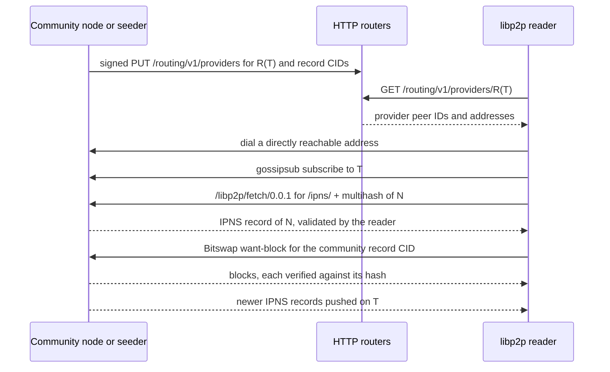

## Abstract

Bitsocial records live on IPFS. A community record is reached through an IPNS name; comments, pages,
and other immutable records by CID; a post's comment update by a path under the community's
`postUpdates` directories. This BSIP specifies how a reader obtains these records over the transports
implementations use today: an IPFS node it trusts, an in-process libp2p node that finds peers through
HTTP routers and receives IPNS records over pubsub, and untrusted HTTP gateways. It defines what a
reader must verify whatever the transport, how it learns of new records, how it classifies failures
(in particular a community it cannot reach versus one that cannot be found), and what a node must
publish and announce so that readers on every transport can reach its records.

## Motivation

The Core BSIPs define each record, how it is addressed, and how it is verified, but none says how a
reader actually obtains it, from whom, or what a node must announce to be found. Two implementations
can each follow the Core BSIPs and still not see each other's communities. A node that publishes its
IPNS record only to the DHT is invisible to a browser that resolves names over pubsub and finds peers
through HTTP routers. A reader that accepts a gateway's resolution of a name can be handed any record.
A client that reports a community hosted behind NAT as "not found" sends its user and the community's
owner after the wrong problem. This BSIP is the shared networking contract that closes those gaps.

## Specification

The key words "MUST", "MUST NOT", "REQUIRED", "SHALL", "SHALL NOT", "SHOULD", "SHOULD NOT",
"RECOMMENDED", "NOT RECOMMENDED", "MAY", and "OPTIONAL" in this document are to be interpreted as
described in [RFC 2119](https://www.rfc-editor.org/rfc/rfc2119) and
[RFC 8174](https://www.rfc-editor.org/rfc/rfc8174).

### Terms

- **Reader**: an implementation that loads records, either a client or a node loading a community it
  does not run.
- **Node**: the IPFS node that runs a community and publishes its records. For a delegated community
  it is the minter's node ([BSIP-11](./bsip-11.md)).
- **Seeder**: a node that keeps another community's records available. It cannot sign records.
- **Trusted IPFS node**: an IPFS implementation the reader runs or controls and reaches over a
  channel it trusts, for example a local Kubo daemon through its RPC API.
- **Gateway**: an HTTP server implementing the
  [IPFS path gateway specification](https://specs.ipfs.tech/http-gateways/path-gateway/), optionally
  also the [subdomain gateway specification](https://specs.ipfs.tech/http-gateways/subdomain-gateway/).
  Readers treat every gateway as untrusted.
- **HTTP router**: an HTTP server implementing the provider endpoints of
  [Delegated Routing V1](https://specs.ipfs.tech/routing/http-routing-v1/).
- **IPNS topic** of an IPNS name `N`: the gossipsub topic on which records for `N` are exchanged under
  the [IPNS PubSub Router specification](https://specs.ipfs.tech/ipns/ipns-pubsub-router/): the string
  `/record/` followed by the unpadded base64url encoding of the routing key, where the routing key is
  the bytes of `/ipns/` followed by the binary multihash of `N`
  ([BSIP-10](./bsip-10.md#key-addresses)).
- **Routing CID** of a topic `T`: the CIDv1 with the `raw` codec (`0x55`) whose multihash is the
  sha2-256 of the UTF-8 string `floodsub:` followed by `T`. It is the key under which nodes announce,
  and readers look up, the peers that serve topic `T`. It addresses no content.

### Records and their addresses

| Record | Addressed by | Mutable | Specified in |
| --- | --- | --- | --- |
| Community record | IPNS name of its signing key (through the anchor's name when delegated), whose value is `/ipfs/<cid>` | Yes, replaced on every publish | [BSIP-3](./bsip-3.md#fetching-the-community-record), [BSIP-11](./bsip-11.md#loading-and-verifying-a-community-record) |
| Comment record | CID | No | [BSIP-2](./bsip-2.md#addressing-and-fetching) |
| Page | CID, from `pageCids`, `nextCid`, `replies.pageCids`, or `modQueue.pageCids` | No, but regenerated under new CIDs | [BSIP-3](./bsip-3.md#pages) |
| Post comment update | Path `/ipfs/<postUpdates[b]>/<postCid>/update` | Yes, the directory CID changes | [BSIP-5](./bsip-5.md#fetching-comment-updates) |
| Reply comment update | Embedded in the reply pages of its parent or post | Yes | [BSIP-5](./bsip-5.md#fetching-comment-updates) |
| Statistics record (`statsCid`), community list | CID | No | [BSIP-3](./bsip-3.md), [BSIP-15](./bsip-15.md) |

Every rule below for "immutable records" applies to every record fetched by CID.

### Transports

A reader obtains records over one or more of the following.

1. **A trusted IPFS node.** The reader asks its node to resolve IPNS names and to return files by CID
   or path. The node does its own peer discovery, resolution, and block verification.
2. **A libp2p node of its own** (for example Helia, in a browser tab or in Node.js) that finds peers
   through HTTP routers, resolves IPNS names over IPNS-over-pubsub, and fetches blocks over
   [Bitswap](https://specs.ipfs.tech/bitswap-protocol/). See
   [Discovery for libp2p readers](#discovery-for-libp2p-readers).
3. **Gateways.** The reader fetches over HTTP and verifies everything itself.
4. **A node it trusts over the RPC protocol** ([BSIP-17](./bsip-17.md)). Such a client delegates
   fetching and verification to that node and inherits its trust; this BSIP applies to the node.

A reader MAY use any of them and MAY combine them. The current implementation uses one transport per
instance: a Kubo RPC client if configured, otherwise its libp2p client, otherwise every configured
gateway in parallel. It refuses a configuration with both a Kubo client and a libp2p client.

### Verifying what was fetched

These rules hold on every transport.

1. **Immutable records.** A reader MUST check that the bytes of a record fetched by CID produce that
   CID under the computation of [BSIP-2](./bsip-2.md#addressing-and-fetching). It MUST compute this
   itself for bytes received from a gateway. It MAY rely on a trusted IPFS node, or on its own libp2p
   node, which verifies every block against its hash as it fetches it.
2. **Records fetched by path.** The bytes of a post comment update cannot be checked against the
   directory CID without verifying every block on the path. A reader that receives one from a gateway
   MUST verify it as [BSIP-5](./bsip-5.md#verification) requires (signature, signer, and `cid`
   binding) before using it or remembering the path as checked, including when it is not newer than
   the update the reader holds.
3. **IPNS records.** An IPNS record MUST be valid for its name under the
   [IPNS Record specification](https://specs.ipfs.tech/ipns/ipns-record/): its signature verifies
   against the key the name commits to, and its validity has not passed. Among valid records for the
   same name, the current one is the one with the higher sequence, and on equal sequence the later
   validity. A reader MUST reject a serialized IPNS record larger than 10 KiB.
4. **No delegated trust.** A reader MUST NOT accept a gateway's resolution of an IPNS name as proof of
   which record the name points at, except in the single case that
   [BSIP-11](./bsip-11.md#resolving-the-chain) allows: the served community record is signed by the
   key of the name requested. A reader MUST resolve community names itself
   ([BSIP-10](./bsip-10.md#verifying-a-community-name)) and MUST NOT ask a gateway to resolve one, for
   example as `/ipns/<domain>`.
5. **Record rules.** Every record is then verified as its own BSIP requires. A CID proves integrity,
   never authorship.
6. **Freshness.** The record decides freshness, not the transport: a community record replaces the
   one held only when its `updatedAt` is strictly greater
   ([BSIP-3](./bsip-3.md#fetching-the-community-record)), and a comment update likewise
   ([BSIP-5](./bsip-5.md#fetching-comment-updates)). An older record is ignored, not an error.
7. **Gateway metadata.** Response headers, status codes, and redirects (`ETag`, `Cache-Control`,
   `X-Ipfs-Roots`, `304 Not Modified`) MAY be used to skip work or to schedule the next request. They
   MUST NOT cause a reader to accept or adopt a record.

Size limits bound what a reader downloads. A reader MUST stop reading a response once it exceeds the
limit it applies, rather than buffering it, and MUST treat the record as invalid.

| Record | Limit |
| --- | --- |
| Community record | 1 MiB (1,048,576 bytes) |
| Comment record | 1 MiB |
| Post comment update | 1 MiB |
| Page | As in [BSIP-3, Pages](./bsip-3.md#pages): 1 MiB for a first page, twice the previous page for each `nextCid`, at most 32 MiB |
| IPNS record | 10 KiB |

A node MUST NOT publish a community record or comment update larger than 1 MiB. Readers MAY refuse
any record above these limits; the current implementation does.

### Loading a community record

A reader follows [BSIP-3](./bsip-3.md#fetching-the-community-record) and the chain and verification
rules of [BSIP-11](./bsip-11.md#loading-and-verifying-a-community-record). This section adds what
depends on the transport. A reader that has already consumed the CID an IPNS name resolves to SHOULD
NOT fetch it again.

#### Over an IPFS node or libp2p

The reader resolves one hop at a time and reads each record's own value, as
[BSIP-11](./bsip-11.md#resolving-the-chain) requires. With Kubo this is `name/resolve` with
`recursive=false`. It then fetches the terminal CID as an immutable record.

#### Over gateways

1. The reader requests `GET <gateway>/ipns/<name>`, where `<name>` is the key address being loaded.
   The current implementation writes it as a base36 CIDv1 (`k51…`) and switches to the subdomain form
   `<name>.ipns.<host>` for a gateway that has redirected it there.
2. It computes the CID of the body. If the body is a community record signed by the key of `<name>`,
   the chain is `[<name>]`. Otherwise it walks and validates the chain through the same gateway with
   `GET <gateway>/ipns/<name>?format=ipns-record` (`Accept: application/vnd.ipfs.ipns-record`), as
   [BSIP-11](./bsip-11.md#resolving-the-chain) specifies. Gateways used to load delegated communities
   MUST support this format.
3. The reader SHOULD send `If-None-Match` listing, as entity-tags in
   [RFC 9110](https://www.rfc-editor.org/rfc/rfc9110) syntax, the `ETag` values of records it has
   already consumed, kept verbatim with any `W/` prefix removed, and the quoted CIDs of its most
   recent records. A `304 Not Modified` means the gateway still holds the record the reader has; it
   is not a failure. A reader MAY abort before reading a body whose `ETag` names a record it has
   consumed.
4. A reader SHOULD send each request to several gateways at once. The first response that verifies
   and is newer than the held record is adopted, and the other requests are aborted. If every
   gateway fails, the load fails with the per-gateway errors; if any gateway confirmed the held
   record (a 304 or a matching `ETag`), there is no new record and no error.

The current implementation queries at most 3 gateways at a time, gives each request the
community-load timeout, and in browsers bypasses the HTTP cache for `/ipns/` requests and prefers
cached responses for `/ipfs/` requests.

#### Learning of new records

A reader learns of a new community record by one of these means:

- **Pushes.** A libp2p reader stays subscribed to the IPNS topic of every name in the community's
  chain, and a valid record that is newer than the one it holds is the signal to load. It SHOULD also
  revalidate on a timer, for pushes it missed. The current implementation does so every
  `updateInterval` (default 60 seconds) multiplied by a random factor between 0.75 and 1.25, forces a
  network lookup on those ticks at most once every 30 seconds, and skips the forced lookup while the
  topic's push channel is healthy: it has subscribers, and a valid record with a sequence at least as
  high as any seen arrived within the last 15 minutes.
- **IPNS caching.** A reader MAY answer a resolution from an IPNS record it holds, without a network
  lookup, for up to the record's TTL after the record was last confirmed current or, while the push
  channel of its topic is healthy, for as long as the record is valid. It MUST NOT use a record whose
  validity has passed.
- **Polling a trusted node.** The current implementation resolves through Kubo every second, bypassing
  Kubo's cache, because Kubo exposes no push signal.
- **Polling gateways.** A gateway's `Cache-Control: max-age` on an `/ipns/` response is the remaining
  TTL of the record in its cache, and polling sooner returns the same record. A reader SHOULD schedule
  its next gateway poll after the smallest `max-age` its gateways reported, and SHOULD add random
  jitter so that communities loaded together are not polled in lockstep. The current implementation
  waits that `max-age` plus 0.25 to 1 second, or 10 seconds multiplied by a random factor between 0.75
  and 1.25 when no gateway sent a `max-age`, and keeps the wait between 1 second and `updateInterval`.

### Loading immutable records

Comment records, pages, statistics records, and community lists are fetched by CID.

- **Over an IPFS node or libp2p**, the reader fetches the file by CID with the size limit above. The
  current implementation retries a page or comment-update fetch up to 3 times, after 1, 2, and 4
  seconds, when the failure is a transient connection error, and never for invalid content or a
  timeout.
- **Over gateways**, the reader requests `GET <gateway>/ipfs/<cid>` (the current implementation writes
  the CID as a CIDv1) and SHOULD query several gateways at once. The first response whose bytes
  produce the CID is the result, and the other requests are aborted. A response that fails
  verification counts as that gateway's failure; the reader continues with the others.
- **From pages.** A reader MAY take a comment record from an entry of a page that verified under
  [BSIP-3](./bsip-3.md#signing), since that entry is bound to the CID it stands for.

Pages and the community records that list them are regenerated under new CIDs
([BSIP-3](./bsip-3.md#pages)). A reader MUST expect a page of a superseded community record to become
unavailable and MUST NOT treat page CIDs as permanent identifiers.

### Loading comment updates

A reader locates a post's comment update as [BSIP-5](./bsip-5.md#fetching-comment-updates) specifies
and fetches it by path, with the 1 MiB limit. It MAY instead use the update carried by a verified page
entry of the current community record when that update is newer than the one it holds; the current
implementation checks the preloaded pages first and fetches by path only otherwise, each time it
adopts a new community record.

1. The reader tries the eligible buckets from smallest to largest. A failure to fetch (timeout, no
   provider, every gateway failing to answer) moves it to the next bucket. An invalid update (bad
   JSON, schema, size, or signature) stops the lookup and is reported; the reader does not try
   further buckets for that community record.
2. Over gateways it requests `GET <gateway>/ipfs/<postUpdates[b]>/<postCid>/update` from several
   gateways at once, and a response counts only once it has passed the verification of rule 2 in
   [Verifying what was fetched](#verifying-what-was-fetched).
3. Over a trusted IPFS node or its own libp2p node, a reader MAY first resolve the path to the CID of
   the file and skip a file it has already checked. It MUST NOT skip one on a gateway's word.
4. If every bucket fails to fetch, the lookup fails as retriable and runs again with the next
   community record.

A reply's comment update is read from verified reply pages
([BSIP-5](./bsip-5.md#fetching-comment-updates)), which are immutable records.

### Discovery for libp2p readers

A libp2p reader has no DHT. It finds the peers that serve a community through HTTP routers, using the
routing CID of the community's IPNS topic:

1. The reader derives the IPNS topic `T` of the name `N` and its routing CID `R(T)`.
2. It asks its HTTP routers for the providers of `R(T)` with `GET /routing/v1/providers/<R(T)>`. It
   SHOULD query several routers in parallel and merge the results; a router that fails counts as one
   that returned no providers.
3. It dials providers it can reach directly and subscribes to `T`. A libp2p reader SHOULD NOT rely on
   relayed (`/p2p-circuit`) connections to fetch records, because circuit relay v2 limits the data
   and duration of a relayed connection.
4. It fetches the current IPNS record with the [libp2p fetch protocol](https://github.com/libp2p/specs/tree/master/fetch)
   (`/libp2p/fetch/0.0.1`), using the routing key of `N` as the key, from current subscribers of `T`
   and from the providers it found, in parallel, and validates it (rule 3 of
   [Verifying what was fetched](#verifying-what-was-fetched)). If that yields no record, it MAY wait
   for subscribers and query them through the IPNS PubSub Router.
5. It fetches CIDs over Bitswap. Providers of a CID are found through the HTTP routers; the current
   implementation also starts each fetch with up to 3 connected peers, preferring subscribers of the
   community's IPNS topic, since the node that serves the topic normally holds every block of the
   community.

The current implementation stops after the first valid record, tries at most 4 providers per lookup,
bounds each fetch request to 5 seconds, and in browsers dials only WebSocket addresses by default
(WebRTC and WebTransport dials are denied unless the application overrides it). Browsers cannot open
TCP connections, so a browser reader can load a community only from a node that announces a secure
WebSocket (or another browser transport) address.

### Making records reachable

A node that runs a community:

1. MUST add every record it publishes to IPFS with the import settings of
   [BSIP-2](./bsip-2.md#addressing-and-fetching), so that its CID matches, and MUST keep every record
   referenced by its latest community record retrievable. It SHOULD keep the records referenced by a
   superseded community record retrievable for at least 30 minutes, so that readers can finish paging
   through it; the current implementation waits 30 minutes before unpinning them, except purged
   content, which it removes at once.
2. MUST publish, after every new community record, an IPNS record for the name of its signing key
   with the value `/ipfs/<cid>` of that record, with a sequence strictly greater than any it has
   published for the name. It SHOULD set the record's TTL to its publish interval, because the TTL is
   how long every cache, including every gateway, may serve the record; the current implementation
   uses its `publishInterval`, 20 seconds by default. It MUST publish a new record before the previous
   one's validity ends. The current implementation leaves the validity at Kubo's default of 48 hours
   and publishes a new community record, with a new `updatedAt`, on every change and at least every
   15 minutes while running.
3. MUST serve its IPNS records over IPNS-over-pubsub: stay subscribed to the IPNS topic of every name
   it publishes, publish each new record on it, and answer `/libp2p/fetch/0.0.1` requests for those
   records. Kubo does this when `Ipns.UsePubsub` is enabled. A node MAY also publish to the DHT, but
   readers of this protocol do not depend on it.
4. MUST announce itself to HTTP routers as a provider of the routing CID of the IPNS topic of its
   name and, when its record has a `pubsubTopic`, of the routing CID of that topic
   ([BSIP-4](./bsip-4.md#transport)). It SHOULD also announce the CIDs of the records it publishes.
   HTTP routers drop announcements after 24 hours, so it MUST re-announce within that window. The
   current implementation pins and announces both routing CIDs at start and every hour, re-announces
   them when its browser-dialable addresses change (checked every minute), and announces each
   community record recursively and each comment record, page, and statistics record as it adds
   them.
5. SHOULD be directly reachable on at least one address a browser can dial, such as a secure
   WebSocket address (Kubo provides one through AutoTLS on a publicly reachable node). A node behind
   NAT announces only `/p2p-circuit` addresses, and libp2p readers cannot load from it
   ([Failures](#failures)).
6. For a delegated community, MUST also publish and keep providing the anchor record as
   [BSIP-11](./bsip-11.md#setting-up-and-rotating-a-minter) specifies.

Any node MAY seed a community: keep the records referenced by its current community record (first
pages and `postUpdates` directories) retrievable, subscribe to its IPNS topic and challenge topic, and
announce their routing CIDs to HTTP routers. A publicly reachable seeder lets browser readers load a
community whose node is behind NAT. A seeder can rebroadcast the latest IPNS record but cannot extend
its validity or sign a new one.

### HTTP routers

An HTTP router used for Bitsocial discovery:

- MUST serve `GET /routing/v1/providers/<cid>` and accept `PUT /routing/v1/providers` announcements
  as specified in [IPIP-0526](https://github.com/ipfs/specs/blob/4d13666f1d2915e03e6f8f8f86a710779e826e8a/src/ipips/ipip-0526.md);
- MUST verify the signature of every announced record against the peer ID it names, as IPIP-0526
  specifies, and reject the announcement otherwise, so that no one can publish addresses under another
  peer's ID;
- SHOULD keep an announcement for 24 hours and then drop it;
- is not used for IPNS records or peer routing. Readers and nodes MUST NOT depend on a router for
  them.

A router can only say which peers claim to serve a CID; every record those peers return is verified
by the reader. The current implementation configures a Kubo node it controls to send
`find-providers` and `provide` to all configured routers in parallel, with errors ignored and a 10
second timeout per router, and to use no router for IPNS or peer lookups. Its libp2p client queries
all configured routers in parallel and treats a failing router as one with no providers.

### Failures

A reader classifies the outcome of a load as one of:

| Outcome | Meaning | Retried | Example codes in the current implementation |
| --- | --- | --- | --- |
| **Unchanged** | A source confirmed the record already held: a 304, an `ETag` or CID already consumed | Not a failure | — |
| **Not found** | No source returned a record within the timeout | Yes | `ERR_RESOLVED_IPNS_P2P_TO_UNDEFINED`, `ERR_IPNS_RESOLUTION_P2P_TIMEOUT`, `ERR_FETCH_CID_P2P_TIMEOUT`, `ERR_FAILED_TO_FETCH_COMMUNITY_FROM_GATEWAYS` |
| **Unreachable from this client** | Providers were found, but this client cannot connect to any of them | Yes | `ERR_COMMUNITY_UNREACHABLE_FROM_THIS_CLIENT` |
| **Transport error** | The reader's own node or a gateway could not be reached | Yes | `ERR_FAILED_TO_RESOLVE_IPNS_VIA_IPFS_P2P`, `ERR_FAILED_TO_FETCH_IPFS_CID_VIA_IPFS_P2P` |
| **Invalid** | A record was received and failed verification | No, for that record | `ERR_CALCULATED_CID_DOES_NOT_MATCH`, `ERR_OVER_DOWNLOAD_LIMIT`, `ERR_COMMUNITY_SIGNATURE_IS_INVALID`, `ERR_GATEWAY_IPNS_RECORD_CHAIN_INVALID`, `ERR_COMMENT_UPDATE_SIGNATURE_IS_INVALID` |

- **Not found is not absence.** A failure to obtain a record never proves that it does not exist. A
  reader MUST NOT present a community or comment as nonexistent, deleted, or removed because it
  could not be fetched.
- **Unreachable differs from not found.** A reader that sees the provider list MUST report
  "unreachable from this client", not "not found", when it found at least one provider, reached no
  subscriber of the topic, and every provider failed a check it can make locally: it announced only
  `/p2p-circuit` addresses, or no address that uses a transport the reader has and that the reader's
  connection policy allows. A provider that the reader dialed, successfully or not, does not count as
  failing. The current implementation reports the reason `relay-only-providers` when every provider
  was relay-only and `no-dialable-provider-addrs` otherwise, with the per-provider verdicts and
  announced addresses. Readers that cannot see providers, such as those using Kubo or gateways, never
  report it.
- **Invalid records stay rejected.** A reader MUST NOT adopt any value from an invalid record and
  SHOULD NOT fetch the same CID again; the current implementation remembers the last 30 community
  record CIDs it consumed or rejected. Since a gateway can serve a stale cached record, the current
  implementation keeps retrying when a gateway's community record has an invalid signature.
- **Retries.** A reader keeping a community up to date SHOULD retry the retriable outcomes with
  exponential backoff. The current implementation retries indefinitely, doubling the delay up to 30
  seconds. Its one-shot load fails on the first invalid outcome, at its timeout, or on the first
  unreachable outcome, since waiting does not change which addresses providers announce.

The current implementation uses these timeouts by default:

| Operation | Timeout |
| --- | --- |
| Resolving a community's IPNS name, or each gateway request for it | 5 minutes |
| Fetching a community record by CID | 1 minute |
| Fetching a comment record | 1 minute |
| Fetching a post comment update | 2 minutes |
| Fetching a page | 30 seconds |
| Fetching any other CID | 30 seconds |

## Rationale

- **Verification does not depend on the transport.** Every record is content-addressed or signed, so
  one set of checks makes every source equally safe, and a reader can switch transports without
  changing what it trusts. A source can withhold or delay records; it cannot forge them.
- **Gateways are untrusted but supported.** Some environments cannot run a libp2p node, and a gateway
  is the cheapest way to read. Requiring readers to verify gateway responses keeps them safe, and
  racing several gateways limits what one slow or withholding gateway can do.
- **HTTP routers instead of the DHT.** Browsers cannot take part in the DHT, and lookups in it are
  slow. A router only maps a CID to peers, stores no content, and can be replaced by changing a URL.
- **IPNS over pubsub.** Pushes deliver a new community record in under a second and need no DHT,
  where a reader that polls a cache sees it only once the cached record's TTL expires. The libp2p
  fetch protocol lets a reader get the current record the moment it connects, without waiting for a
  gossipsub mesh.
- **The `floodsub:` routing CID.** It is the key go-libp2p's pubsub discovery uses for a topic, so a
  Kubo node finds the peers of a topic it joins through the same HTTP routers that libp2p readers
  query, with no Bitsocial-specific discovery.
- **TTL equal to the publish interval.** The TTL bounds how stale a cache may be. A longer TTL lets
  gateway readers lag several records behind; a shorter one only causes more lookups than there are
  new records.
- **Conditional requests and `max-age` pacing.** An unchanged poll costs one bodyless 304, so polling
  at the moment a gateway's cache expires is both fresher and cheaper than a fixed long interval.
- **Unreachable versus not found.** Most home nodes are behind NAT, and a browser cannot reach them.
  Reporting that case as "not found" tells users the community is gone; naming it tells the owner to
  get a public address or a seeder.

Open questions:

- A gateway reader of an ordinary community checks the record's signature but not the IPNS record's
  sequence or validity ([BSIP-11](./bsip-11.md#resolving-the-chain) allows the single request). Should
  readers always fetch `?format=ipns-record`, at the cost of a second request per poll?
- The current implementation announces the routing CIDs of a delegated community's minter topic and
  challenge topic, but not explicitly that of the anchor's IPNS topic, which readers look up first. It
  depends on the IPFS implementation's pubsub discovery to announce it. Should the node be required
  to announce it?
- IPNS validity is left at Kubo's 48 hour default. A community whose node stays offline longer becomes
  unloadable on every transport that validates IPNS records, and seeders cannot extend it. Should a
  minimum validity be specified?
- The current implementation uses one transport per instance. Should a reader fall back to gateways
  when it finds a community unreachable over libp2p?
- Verifiable gateway responses (`application/vnd.ipld.car`) would let a reader verify comment-update
  paths and IPNS resolution from a gateway. They are not used today.
- Readers do not persist the highest IPNS sequence they have seen per name, so a source can roll a
  fresh reader back to an older valid record ([Security Considerations](#security-considerations)).

## Backwards Compatibility

This BSIP introduces no wire format; it describes the behavior of pkc-js 0.0.135. Earlier versions of
the implementation published IPNS records with a TTL of three publish intervals; those records are
valid, and gateway readers see their updates later. Kubo releases before 0.43.0 dropped
browser-dialable addresses from announcements to HTTP routers, so nodes running them are not
reachable from browsers without an address-rewriting proxy, which the implementation no longer uses.
A node that publishes IPNS records only to the DHT, or does not announce its routing CIDs to HTTP
routers, cannot be loaded by libp2p readers or by Kubo readers configured by the current
implementation, which use no DHT.

## Reference Implementation

Non-normative. The current implementation is [pkc-js](https://github.com/pkcprotocol/pkc-js):

- [`src/clients/base-client-manager.ts`](https://github.com/pkcprotocol/pkc-js/blob/master/src/clients/base-client-manager.ts):
  the gateway race, size limits, and CID check of gateway responses (`fetchFromMultipleGateways`,
  `_fetchWithLimit`), hop-by-hop IPNS resolution (`resolveIpnsToCidP2P`), and CID fetches through a
  node (`_fetchCidP2P`).
- [`src/community/community-client-manager.ts`](https://github.com/pkcprotocol/pkc-js/blob/master/src/community/community-client-manager.ts):
  the community update loop, gateway loading with conditional requests and `max-age` pacing
  (`_fetchCommunityFromGateways`), and push-driven updates; winner selection in
  [`src/community/community-gateway-selection.ts`](https://github.com/pkcprotocol/pkc-js/blob/master/src/community/community-gateway-selection.ts).
- [`src/util.ts`](https://github.com/pkcprotocol/pkc-js/blob/master/src/util.ts): IPNS topic and
  routing CID derivation (`ipnsNameToIpnsOverPubsubTopic`, `pubsubTopicToDhtKeyCid`), raw IPNS record
  validation from gateways (`fetchAndValidateIpnsRecordFromGateway`), and bucket selection
  (`getPostUpdateTimestampRange`).
- [`src/helia/helia-for-pkc.ts`](https://github.com/pkcprotocol/pkc-js/blob/master/src/helia/helia-for-pkc.ts)
  and [`src/helia/util.ts`](https://github.com/pkcprotocol/pkc-js/blob/master/src/helia/util.ts): the
  libp2p reader, its IPNS cache and push channel, direct record fetch from providers, and the
  reachability verdicts described in
  [`docs/reachability.md`](https://github.com/pkcprotocol/pkc-js/blob/master/docs/reachability.md).
- [`src/publications/comment/comment-client-manager.ts`](https://github.com/pkcprotocol/pkc-js/blob/master/src/publications/comment/comment-client-manager.ts)
  and [`src/pages/pages-client-manager.ts`](https://github.com/pkcprotocol/pkc-js/blob/master/src/pages/pages-client-manager.ts):
  comment, comment update, and page fetches.
- [`src/runtime/node/community/local-community/ipns-publishing.ts`](https://github.com/pkcprotocol/pkc-js/blob/master/src/runtime/node/community/local-community/ipns-publishing.ts),
  [`pubsub.ts`](https://github.com/pkcprotocol/pkc-js/blob/master/src/runtime/node/community/local-community/pubsub.ts),
  [`reprovide-on-address-change.ts`](https://github.com/pkcprotocol/pkc-js/blob/master/src/runtime/node/community/local-community/reprovide-on-address-change.ts),
  and [`cleanup.ts`](https://github.com/pkcprotocol/pkc-js/blob/master/src/runtime/node/community/local-community/cleanup.ts):
  the node side; Kubo router configuration in
  [`src/runtime/node/setup-kubo-http-routers.ts`](https://github.com/pkcprotocol/pkc-js/blob/master/src/runtime/node/setup-kubo-http-routers.ts).

An HTTP router implementing the rules above is
[pkc-http-router](https://github.com/pkcprotocol/pkc-http-router).

## Security Considerations

- **Withholding and rollback.** No source can forge a record a reader verifies, but any source can
  withhold records or serve older valid ones. Within a session, the `updatedAt` rule stops a reader
  from going back to an older record. A fresh reader has no reference point: over gateways the first
  verified record wins, so a fast gateway serving an old community record is believed until another
  source returns a newer one, and the libp2p record fetch takes the first valid record without
  comparing sequences across peers. Readers SHOULD use several independent gateways, routers, and
  peers.
- **Delegation rollback.** The same applies to anchor records, where it can pin a reader to a revoked
  minter; see [BSIP-11](./bsip-11.md#security-considerations).
- **Trusted nodes.** A reader that relies on a node to verify content inherits that node's honesty.
  The current implementation does not re-hash files it receives from a configured Kubo RPC endpoint,
  so a dishonest endpoint could substitute content. A reader SHOULD rely only on nodes it controls,
  and SHOULD verify CIDs itself for any other.
- **HTTP routers.** A router can hide providers or return peers that hold nothing, which denies
  service but cannot inject content. Without signed announcements anyone could publish addresses
  under another peer's ID and make it unreachable for everyone; routers therefore verify every
  announcement. A valid signature still proves only who announced, not that the peer has the content.
- **Resource exhaustion.** Size limits enforced while streaming, a cap on concurrent gateway requests,
  the one-hop limit on IPNS chains, the 10 KiB IPNS record limit, and per-operation timeouts bound
  the work a hostile source can cause. Readers that do not stream SHOULD still reject a
  `Content-Length` above the limit before reading.
- **Privacy.** Gateways and HTTP routers learn which communities and records a reader asks for, and
  from which IP address. Subscribing to an IPNS topic and sending Bitswap requests reveal the same to
  peers. Readers that care SHOULD use their own node or sources they trust, and SHOULD fetch on demand
  rather than prefetching every reference.
- **Availability.** A record is available only while some node holds it. Page CIDs disappear after a
  community regenerates them, comment records disappear when no node keeps them, and an IPNS record
  stops resolving when its validity ends, so a node offline longer than its record's validity makes
  the community unloadable on every transport that validates IPNS records until it publishes again.
- **NAT and relays.** A community whose only providers sit behind NAT is unreachable from libp2p
  readers. Telling users so, rather than "not found", avoids pushing them to look-alike communities
  that do load.

## Copyright

Copyright and related rights waived via [CC0](../LICENSE.md).
