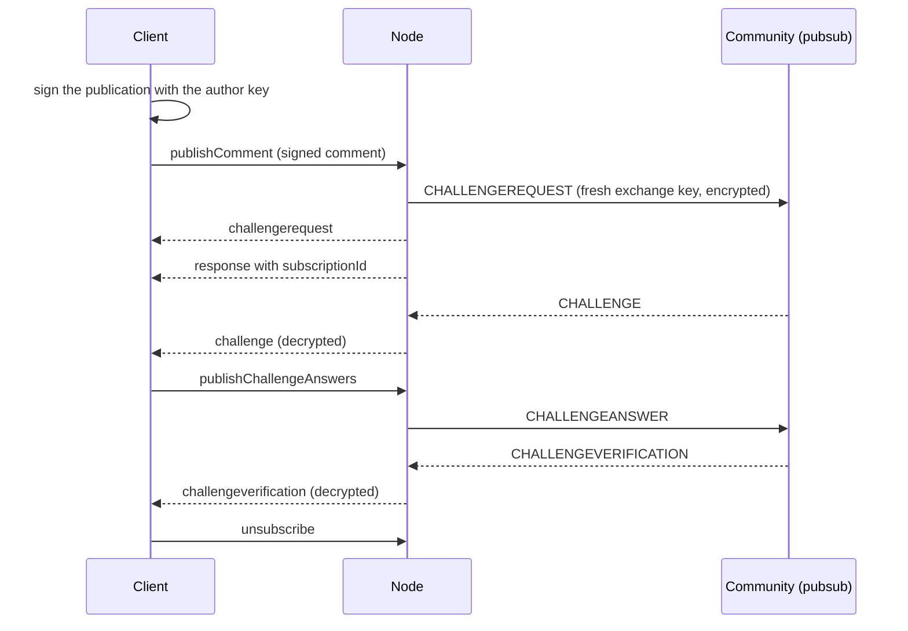

## Abstract

This BSIP specifies the JSON-RPC 2.0 protocol, carried over a WebSocket, through which a client uses
a full Bitsocial node instead of joining the peer-to-peer network itself. Over one connection a
client reads comments, pages, and communities; subscribes to their updates; publishes comments,
votes, edits, and moderation through the challenge exchange; and creates, runs, edits, and exports
the communities the node hosts. Records cross the protocol unchanged, and the values the node
computes about them travel beside them in a separate `runtimeFields` object. The client signs every
publication itself, so the author's key never reaches the node; the node runs the challenge exchange
on the client's behalf and relays it. This BSIP defines the framing, authentication, the method
catalogue, subscriptions and their notifications, the state names clients rely on, errors,
compatibility rules, and what a client entrusts to its node.

## Motivation

A full node fetches records from IPFS and gateways, joins gossipsub topics, resolves names against
chains, and holds community keys and databases. Browsers and phones can do little of this: they
cannot run an IPFS node, keep long-lived pubsub subscriptions, or stay online to publish a community.
They connect instead to a node, the user's own (for example a desktop daemon) or a hosted one, and
ask it to do that work.

Web and mobile clients already depend on this protocol, and so do the nodes that serve them. Until
now it was defined only by its implementation in pkc-js and by a README that had drifted from it. An
independent node must answer the same methods with the same shapes, and an independent client must
interpret the same notifications and states, or neither can replace the other. This BSIP is that
shared definition. It also states plainly what a client gives up by delegating to a node, which
matters more as hosted nodes serve users who do not run their own.

## Specification

The key words "MUST", "MUST NOT", "REQUIRED", "SHALL", "SHALL NOT", "SHOULD", "SHOULD NOT",
"RECOMMENDED", "NOT RECOMMENDED", "MAY", and "OPTIONAL" in this document are to be interpreted as
described in [RFC 2119](https://www.rfc-editor.org/rfc/rfc2119) and
[RFC 8174](https://www.rfc-editor.org/rfc/rfc8174).

### Terminology

- **Node** — the server side of this protocol: a full implementation that fetches and verifies
  records ([BSIP-16](./bsip-16.md)), takes part in pubsub, resolves names, and may run communities.
- **Client** — the program connected to a node over this protocol.
- **Local community** — a community whose signing key and database the node holds; it appears in the
  node's [communities list](#node-lists-and-settings). Every other community is **remote** to the
  node.
- **Wire record** — a signed or content-addressed record exactly as its BSIP defines it: a comment
  record ([BSIP-2](./bsip-2.md)), a community record or page ([BSIP-3](./bsip-3.md)), a comment
  update ([BSIP-5](./bsip-5.md)), or a community list ([BSIP-15](./bsip-15.md)). Messages of the
  challenge exchange ([BSIP-4](./bsip-4.md)) cross this protocol decrypted and re-encoded
  ([Records on the wire](#records-on-the-wire)); the wire records inside them are verbatim.
- **Runtime field** — a value the node computes about a wire record: a name-verification outcome, a
  fetch state, a CID, a resolved IPNS chain.
- **Subscription** — a stream of notifications on one connection, created by a subscribe, start, or
  publish method and identified by a **subscription id**.
- **Community identifier** — the parameter object `{ "name"?: string, "publicKey"?: string }` naming a
  community by its name, its identity key ([BSIP-10](./bsip-10.md#key-addresses)), or both. At least
  one member is REQUIRED.

### Transport and framing

A node exposes the protocol as a WebSocket endpoint ([RFC 6455](https://www.rfc-editor.org/rfc/rfc6455)),
at `ws://` or `wss://`. Every message is one text frame holding one UTF-8 JSON value, and follows
[JSON-RPC 2.0](https://www.jsonrpc.org/specification) with the constraints below.

A **request** is:

```jsonc
{ "jsonrpc": "2.0", "id": 1, "method": "getComment", "params": [{ "cid": "Qm…" }] }
```

- `params` is an array holding exactly one object, the method's parameter object, or no element for
  a method that takes none. A node reads `params[0]` and ignores any further elements.
- A client MUST give every request an `id`. A node executes a request without `id` but sends no
  response, so its result, including any subscription id, is lost.
- This protocol does not use JSON-RPC batches. The reference node accepts them; clients SHOULD NOT
  send them.

A **response** carries the request's `id` and either `result` or `error`
([Errors](#errors)). Every `result` is a JSON object, never a bare scalar, so that members can be
added later.

A **notification** is a message from the node with no `id`:

```jsonc
{
  "jsonrpc": "2.0",
  "method": "commentUpdateNotification",
  "params": { "subscription": 7194037110274, "event": "updatingstatechange", "result": { "state": "fetching-ipfs" } }
}
```

- `params.subscription` is the subscription id, `params.event` the event name, and `params.result`
  its payload, always a JSON object.
- Clients MUST route a notification by `params.subscription` and `params.event`. The `method` name is
  informational and not consistent across subscription types
  ([Subscriptions](#subscriptions)).
- A node sends a subscription's notifications in the order their events occurred. It MAY send them
  before the response that returns the subscription id; every subscription that has a current state
  sends it that way ([Subscriptions](#subscriptions)). A client MUST therefore buffer notifications
  for subscription ids it does not know yet, and deliver them in arrival order once the id is known.

### Connection and authentication

A node accepts two kinds of connection:

- **Local**: the connection comes from the node's own host, meaning the socket's remote address
  equals its local address, and the upgrade request carries no `X-Forwarded-For` header. A local
  connection needs no credential and uses the path `/`.
- **Remote**: any other connection. Its request path MUST be exactly `/` followed by the node's
  **auth key**, for example `wss://node.example:9138/<authKey>`, with no query string. A node without
  an auth key accepts local connections only.

A node rejects any other upgrade with HTTP status 403. A client that receives 403 MUST NOT reconnect
automatically: the credential is wrong, and retrying cannot fix it. Because the auth key travels in
the request path, a remote connection SHOULD use `wss://`.

Whoever holds a connection can call every method. The protocol has no accounts, roles, or
per-method permissions; the auth key is a single bearer credential for the whole node.

**Connection-scoped state.** Every subscription belongs to the connection that created it. When a
connection closes, the node ends all of its subscriptions: it stops in-flight publications, stops
fetching updates on that connection's behalf, and keeps no notifications for it. Two things outlive
a connection:

- A local community started by [`startCommunity`](#running-local-communities) keeps running until a
  client calls `stopCommunity` or `deleteCommunity`, or the node shuts down. A node SHOULD record
  which local communities were started and not explicitly stopped, and start them again when it
  restarts.
- Exports ([Export](#export)) continue, and their files remain downloadable.

**HTTP on the same port.** The HTTP server that carries the WebSocket upgrade also serves
`GET /exports/<exportId>` ([Export](#export)). That route takes no auth key: the export id is the
credential.

### Records on the wire

**Wire records travel verbatim.** A wire record crosses the protocol as a JSON value, under a named
member of the payload (`comment`, `commentUpdate`, `community`, `page`), or as the whole result of
`getComment`. A node MUST NOT add, remove, or change any member of a wire record, at any depth,
including members it does not recognize, so that its signatures and CIDs stay verifiable on the
client ([BSIP-12](./bsip-12.md#preserving-the-embedded-record) gives the strictest case). The one
exception is the publication inside a `challengerequest` event of a start subscription, which the
node annotates ([Subscriptions](#subscriptions)). Wire records carry no `address`; the client derives
runtime addresses as [BSIP-10](./bsip-10.md#runtime-addresses) defines.

**Runtime fields travel beside them.** Values the node computes about a record are sent in a
`runtimeFields` object next to the record, structured as the path inside the runtime object they
apply to: `runtimeFields.author.nameResolved` describes the author of the comment beside it, and
`runtimeFields.comments[i]` describes `page.comments[i]`. A client applies runtime fields by merging
them into its own runtime objects, never into the wire record, and a node MUST NOT write a runtime
field into a wire record. An absent runtime field means the node has no value for it.

| Runtime field | Where | Meaning |
| --- | --- | --- |
| `nameResolved` | community; `author` of a comment; `comment.author` at each level of a `crosspost` ([BSIP-12](./bsip-12.md)) | The node's outcome for the name: `true` verified, `false` refuted, absent unknown ([BSIP-10](./bsip-10.md#verification-outcomes)). |
| `updateCid` | community | CID of the community record the node holds. |
| `updatingState` | community | The node's [updating state](#states) for the community when it built this payload. |
| `ipnsHops` | remote community | The IPNS chain the node resolved, identity key first ([BSIP-11](./bsip-11.md#the-delegation-chain)). |
| `newPublicKey` | remote community | The key a named community migrated to ([BSIP-10](./bsip-10.md#key-migration)); sent with `resetInstance: true`. |
| `posts.pages.<sort>` | community | Page runtime fields for each preloaded page of `posts`. |
| `replies.pages.<sort>` | comment update | Page runtime fields for each preloaded reply page. |
| `comments[i]` | page | Runtime fields of the `i`-th page entry: `author`, `crosspost`, and `replies.pages.<sort>` for its nested reply pages. |

**Names are resolved by the node.** The node resolves every name with its own resolvers
([BSIP-10](./bsip-10.md#name-resolution)) and reports outcomes as `nameResolved`. A client does not
need resolvers of its own and, when it has none, MUST NOT treat a name it could not resolve as
refuted; it takes the node's outcome. A node with no resolver for a name's TLD fails any request that
needs that name with `ERR_NO_RESOLVER_FOR_NAME`, as a call error or as an `error` event of the
subscription.

**Challenge-exchange messages.** Notifications that carry a message of the challenge exchange
([BSIP-4](./bsip-4.md#message-envelope)) send it decrypted: the envelope members (`type`,
`challengeRequestId`, `signature`, `encrypted`, `protocolVersion`, `userAgent`, `timestamp`, and the
type-specific plaintext members such as `acceptedChallengeTypes`, `challengeSuccess`,
`challengeErrors`, `reason`) plus the members of its decrypted payload (`comment`, `vote`,
`commentEdit`, `commentModeration`, `communityEdit`, `challengeAnswers`, `challengeCommentCids`,
`challenges`, `commentUpdate`) at the top level. Byte strings are encoded as text:

- `challengeRequestId` as base58btc;
- `signature.signature`, `signature.publicKey`, `encrypted.ciphertext`, `encrypted.iv`, and
  `encrypted.tag` as base64 with the standard alphabet and no padding.

**Other encodings.** IPNS sequence numbers are decimal strings, because JSON numbers cannot hold a
64-bit unsigned integer exactly. Binary records a client hands to the node are base64 strings.

### Methods

Each row gives the method, its parameter object (`params[0]`), and its result. Members marked `?`
are OPTIONAL. Exact schemas are in the [reference implementation](#reference-implementation).

| Method | Parameters | Result |
| --- | --- | --- |
| **Reading** | | |
| `getComment` | `{ cid, communityPublicKey?, communityName? }` | The comment record |
| `getCommunityPage` | `{ cid, type, pageMaxSize, communityPublicKey?, communityName? }` | `{ page, runtimeFields? }` |
| `getCommentPage` | `{ cid, commentCid, pageMaxSize, communityPublicKey?, communityName? }` | `{ page, runtimeFields? }` |
| `fetchCid` | `{ cid }` | `{ content }` |
| `resolveAuthorName` | `{ name, cache?: { maxAge? } }` | `{ resolvedAuthorName }` |
| `fetchCommunityList` | `{ cid }` | `{ communityListRawString }` |
| **Subscribing** | | |
| `communityUpdateSubscribe` | community identifier | `{ subscriptionId }` |
| `commentUpdateSubscribe` | `{ cid, communityPublicKey?, communityName? }` | `{ subscriptionId }` |
| `communitiesSubscribe` | none | `{ subscriptionId }` |
| `settingsSubscribe` | none | `{ subscriptionId }` |
| `unsubscribe` | `{ subscriptionId }` | `{ success: true }` |
| **Publishing** | | |
| `publishComment` | `{ comment, challengeAnswers?, challengeCommentCids? }` | `{ subscriptionId }` |
| `publishVote` | `{ vote, challengeAnswers?, challengeCommentCids? }` | `{ subscriptionId }` |
| `publishCommentEdit` | `{ commentEdit, challengeAnswers?, challengeCommentCids? }` | `{ subscriptionId }` |
| `publishCommentModeration` | `{ commentModeration, challengeAnswers?, challengeCommentCids? }` | `{ subscriptionId }` |
| `publishCommunityEdit` | `{ communityEdit, challengeAnswers?, challengeCommentCids? }` | `{ subscriptionId }` |
| `publishChallengeAnswers` | `{ subscriptionId, challengeAnswers }` | `{ success: true }` |
| `publishCommunityList` | `{ communityListRawString }` | `{ cid }` |
| **Running local communities** | | |
| `createCommunity` | community creation options | `{ localCommunity }` |
| `startCommunity` | community identifier | `{ subscriptionId }` |
| `startedCommunitySubscribe` | community identifier | `{ subscriptionId }` |
| `stopCommunity` | community identifier | `{ success: true }` |
| `editCommunity` | `{ name?, publicKey?, editOptions }` | A local community payload |
| `deleteCommunity` | community identifier | `{ success: true }` |
| `prepareAnchorPublish` | community identifier | `{ nextSequence, currentAnchorRecordSequence, hasPersistedAnchorRecord }` |
| `publishAnchorRecord` | `{ name?, publicKey?, recordBase64 }` | `{ sequence, value, anchorPublicKey }` |
| **Export** | | |
| `exportCommunity` | `{ name?, publicKey?, includePrivateKey? }` | `{ exportId }` |
| `exportsSubscribe` | community identifier | `{ subscriptionId }` |
| `cancelExport` | `{ exportId }` | `{ success: true }` |
| `exportCommunityModLogs` | `{ name?, publicKey?, startTimestamp?, endTimestamp?, commentCid?, limit?, order? }` | `{ moderations }` |
| **Node settings** | | |
| `setSettings` | `{ pkcOptions }` | `{ success: true }` |

There is no one-shot method for a community record. A client that wants a community once subscribes
with `communityUpdateSubscribe`, takes the first `update`, and unsubscribes.

#### Reading

The node fetches and verifies every record it returns ([BSIP-16](./bsip-16.md)).

- `getComment` returns the comment record for `cid` ([BSIP-2](./bsip-2.md)), as the whole result.
  `communityPublicKey` and `communityName` are optional hints.
- `getCommunityPage` returns one page of a community's posts (`type: "posts"`) or moderation queue
  (`type: "modqueue"`) ([BSIP-3](./bsip-3.md#pages)). At least one of `communityPublicKey` and
  `communityName` is REQUIRED. `pageMaxSize` is the largest size in bytes the client accepts for this
  page, following the limits of BSIP-3; the node refuses a larger page.
- `getCommentPage` does the same for a page of the replies of the comment `commentCid`
  ([BSIP-5](./bsip-5.md)).
- `fetchCid` returns the content stored under `cid` as a string. A client can check the bytes against
  the CID itself.
- `resolveAuthorName` resolves an author name with the node's resolvers
  ([BSIP-10](./bsip-10.md#name-resolution)). `resolvedAuthorName` is the key address the name
  designates, or `null` when it designates none. `cache.maxAge` is the oldest cached answer, in
  seconds, the node may return; `0` forces a fresh lookup.
- `fetchCommunityList` returns a community list as the exact string stored under `cid`, unparsed;
  [BSIP-15](./bsip-15.md) specifies the checks on both sides.

#### Subscribing to communities and comments

`communityUpdateSubscribe` loads the community and keeps it updated, with the node's resolvers and
its delegation checks ([BSIP-11](./bsip-11.md)). If the node runs the community, the subscription
follows it instead of fetching it. Its `update` payload has one of two shapes:

- For a remote community, the [remote community payload](#community-payloads).
- For a local community, a [local community payload](#community-payloads).

`commentUpdateSubscribe` loads the comment record for `cid` and then keeps its comment update
current ([BSIP-5](./bsip-5.md#fetching-comment-updates)). It sends one `comment` event with the
record, then an `update` event with the node's latest comment update whenever the node's copy
changes. An `update` can repeat one already sent; a client keeps the comment update with the highest
`updatedAt`. The reference client also sends `parentCid`, `postCid`, and, when it already holds them,
`raw: { comment, commentUpdate }`, so the node can skip a fetch; a node MAY ignore these members.

#### Publishing



The five publish methods take the decrypted payload of a `CHALLENGEREQUEST`
([BSIP-4](./bsip-4.md#the-exchange)): exactly one signed publication under its key — `comment`
([BSIP-2](./bsip-2.md)), `vote` ([BSIP-6](./bsip-6.md)), `commentEdit` ([BSIP-7](./bsip-7.md)),
`commentModeration` ([BSIP-8](./bsip-8.md)), or `communityEdit` ([BSIP-9](./bsip-9.md)) — and the
OPTIONAL `challengeAnswers` and `challengeCommentCids`.

- The publication MUST be complete and signed by the client, `signature` included. The node MUST
  NOT accept a private key in place of a signature, and MUST NOT re-sign or alter the publication.
- Before signing, a client needs the target community's identity key and name, which it signs into
  the publication ([BSIP-10](./bsip-10.md#wire-fields)). A client without its own network access gets
  them from the node with `communityUpdateSubscribe`.
- The node loads the community, verifies the publication's signature, and runs the challenge
  exchange as the publishing side of BSIP-4: it generates the fresh exchange keypair, encrypts the
  payload to the community, signs the envelopes, verifies the community's replies, and decrypts them.
  A node MAY retry over another pubsub provider with a new exchange; each attempt sends its own
  `challengerequest` event.
- The node relays the exchange to the client as notifications: `challengerequest`, `challenge`,
  `challengeanswer`, and `challengeverification`, each carrying the decrypted message
  ([Records on the wire](#records-on-the-wire)), plus `publishingstatechange`.
- The client answers a `challenge` with `publishChallengeAnswers`, naming the publication by its
  subscription id. `challengeAnswers` is a non-empty array of strings matching the challenges by
  position. The node encrypts and signs the `CHALLENGEANSWER`.
- The exchange ends with `challengeverification`, or with `publishingstatechange` to `failed`. The
  client SHOULD then `unsubscribe`.
- If the publication fails before the exchange starts, for example because its signature is invalid,
  the community cannot be loaded, or the community disabled its challenge exchange, the node still
  returns a subscription id. It first sends an `error` event whose `details.publishThrowError` is
  `true`, and ends the subscription.

`publishCommunityList` publishes a community list that the client built and signed.
`communityListRawString` is the exact signed JSON text, sent as a string because a re-serialized
object could change the bytes. [BSIP-15](./bsip-15.md) specifies what the node checks before adding
and pinning those bytes, and what the client checks in the returned `cid`.

#### Running local communities

These methods act on local communities. A node looks for a running community with the given name or
identity key, then for a stored one, matching `name` before `publicKey` in each case, so a client
that still holds a community's old name after a rename finds it by its key.

- `createCommunity` creates a local community and returns a local community payload of the first
  shape. Its parameter is the community's initial editable fields and `settings` (the same members as
  `editOptions` below), and at most one of:
  - `signer: { type: "ed25519", privateKey }`, a key to import as the community key;
  - `anchor: { publicKey }`, making a delegated community whose minter key the node generates
    ([BSIP-11](./bsip-11.md#setting-up-and-rotating-a-minter)).

  With neither, the node generates the community key. The new community then appears in the
  communities list.
- `startCommunity` starts a local community: the node publishes its record and answers its challenge
  exchange ([BSIP-4](./bsip-4.md)). If the community is already running, the subscription attaches to
  it. Either way the node sends an `update` with the current state before the response. The
  subscription carries the community's updates, its started state, every challenge exchange it
  handles (decrypted), and its errors. Several clients MAY hold start subscriptions on the same
  community.
- `startedCommunitySubscribe` re-establishes a start subscription, typically after a reconnect. It
  attaches if the community is running, starts it if it was started and never explicitly stopped
  since (for example after a node restart), and otherwise fails with `ERR_RPC_COMMUNITY_NOT_RUNNING`.
  It never overrides a stop.
- `stopCommunity` stops a running local community for every client, sends a final `update` and a
  `startedstatechange` to `stopped` on every start subscription, and records the stop so that the
  community is not restarted automatically. Start subscriptions receive nothing further.
- `editCommunity` applies `editOptions` and returns the resulting local community payload.
  `editOptions` has the members `title`, `description`, `rules`, `roles`, `features`, `suggested`,
  `flairs`, `pubsubTopic`, `name`, and `settings`, with the meanings of [BSIP-3](./bsip-3.md);
  `settings` is node-side configuration that is not published, and `address` is accepted as a legacy
  alias of `name`. A member set to `null`, at any depth, is removed; in `roles`, a `null` entry
  removes that role. Setting or removing `name` renames the community
  ([BSIP-9](./bsip-9.md#renaming)). Challenge and page-sort names in `settings` refer to the node's
  registries, which `settingschange` lists ([Node lists and settings](#node-lists-and-settings)).
- `deleteCommunity` stops the community if it runs, deletes its data, and sends the same final
  notifications as `stopCommunity`.
- `prepareAnchorPublish` and `publishAnchorRecord` are the node's half of setting up or rotating a
  delegated community ([BSIP-11](./bsip-11.md#setting-up-and-rotating-a-minter)). The owner signs the
  anchor record wherever the anchor key is; that key never crosses this protocol.
  - `prepareAnchorPublish` returns `nextSequence`, the sequence the owner should sign;
    `currentAnchorRecordSequence`, the highest the node or the network knows; and
    `hasPersistedAnchorRecord`, whether this node ever accepted an anchor record for the community.
    It fails with `ERR_UNABLE_TO_DETERMINE_ANCHOR_SEQUENCE` rather than answer 0 when no sequence is
    known; for the first anchor record the owner signs sequence 0 without asking.
  - `publishAnchorRecord` takes the signed IPNS record as `recordBase64`. The node checks and
    publishes it as BSIP-11 requires, and returns its `sequence`, its `value`, and the
    `anchorPublicKey` it is for.

A method of this group fails when the identifier names no local community, with the codes listed in
[Errors](#errors).

#### Community payloads

A **remote community payload** is either:

```jsonc
{
  "community": { /* the community record (BSIP-3), verbatim */ },
  "runtimeFields": {
    "updateCid": "Qm…",
    "updatingState": "succeeded",
    "nameResolved": true,
    "ipnsHops": ["12D3KooW…"],
    "posts": { "pages": { "hot": { "comments": [{ "author": { "nameResolved": true } }, {}] } } }
  }
}
```

or, after the community's name moved to a new key and the node discarded the old record
([BSIP-10](./bsip-10.md#key-migration)):

```jsonc
{ "resetInstance": true, "runtimeFields": { "newPublicKey": "12D3KooW…", "nameResolved": true, "updatingState": "fetching-ipns" } }
```

A client receiving `resetInstance` MUST discard the community state it holds and continue under
`newPublicKey`.

A **local community payload** has one of two shapes, depending on whether the community has
published its first record:

- Before: `{ "localCommunity": { … } }`, where `localCommunity` holds the community's fields as the
  node will publish them (`title`, `challenges`, `encryption`, `createdAt`, `protocolVersion`, and so
  on, without `posts` or `modQueue`) together with the local members listed below.
- After: `{ "community": <community record>, "localCommunity": { … }, "runtimeFields": { "updateCid",
  "updatingState"?, "nameResolved"?, "posts"? } }`, where `localCommunity` holds only the local
  members.

The local members are `address`; `signer: { type, publicKey, address, shortAddress }`, the key that
signs the community's records (the minter of a delegated community), never with its private key;
`anchor` and `anchorRecordSequence` for a delegated community; `settings`; `started`, whether the
community is running; `startedState`; and `_usingDefaultChallenge`, whether the node applied its
default challenge because the owner configured none.

#### Node lists and settings

- `communitiesSubscribe` lists the node's local communities. Its `communitieschange` payload is
  `{ "communities": [{ "name"?, "publicKey", "started" }] }`, where `started` is whether the
  community is running. The node sends the list on subscribe and whenever a local community is
  created, deleted, renamed, started, or stopped. A client uses it to tell local communities from
  remote ones.
- `settingsSubscribe` reports the node's configuration. Its `settingschange` payload is
  `{ "pkcOptions": {…}, "challenges": {…}, "pageSorts"?: {…} }`: the node's options, and the
  challenges and page sorts registered on the node, keyed by name and described as their packages
  describe themselves, without code. A client SHOULD reject a challenge or page-sort name the node
  does not list before calling `editCommunity`.
- `setSettings` replaces the node's options with `pkcOptions`. The node ignores any `nameResolvers`
  member and keeps its own resolvers. If the options equal the current ones the call does nothing.
  Otherwise the node switches to the new options, restarts its running local communities under them,
  moves the existing update subscriptions to them, and sends `settingschange` to every settings
  subscriber. The option set is implementation-specific; this BSIP does not standardize it.

#### Export

These methods back up a local community's database. The reference node's backup is a SQLite file.

- `exportCommunity` starts a backup and returns its `exportId` (a UUIDv4) as soon as it is queued.
  With `includePrivateKey: true` the backup includes the community's private key; a node MAY refuse
  this with `ERR_PRIVATE_KEY_EXPORT_NOT_ALLOWED`. It fails with `ERR_COMMUNITY_NOT_FOUND` or
  `ERR_COMMUNITY_NOT_LOCAL` when the identifier names no local community.
- `exportsSubscribe` reports a community's exports. Its `exportschange` payload is
  `{ "records": [ … ] }`, each record `{ exportId, name?, publicKey, includePrivateKey, progress,
  size?, sha256?, url?, error? }`. `progress` runs from 0 to 1; at 1 the record carries `size`,
  `sha256` (hex), and `url`; a failed or cancelled export carries `error: { code, message }`, with
  code `ERR_EXPORT_CANCELLED` for a cancellation. `url` is the relative path `/exports/<exportId>`,
  which the client resolves against the node's HTTP origin (the WebSocket URL with `ws` replaced by
  `http`, `wss` by `https`, and the path removed). The node sends the list on subscribe and on every
  change. Ending the subscription does not cancel exports.
- `cancelExport` cancels an export in progress. It succeeds for an unknown or finished export.
- `GET /exports/<exportId>` returns the file with status 200 and `Content-Type:
  application/vnd.sqlite3`, 404 when there is none, and 405 for other methods. After a complete
  download the node deletes the file and the record. A node SHOULD delete export files that are never
  downloaded after a bounded time (the reference node: 24 hours, checked at startup).
- `exportCommunityModLogs` returns the comment moderations ([BSIP-8](./bsip-8.md)) the community
  accepted, as `{ "moderations": [ … ] }`: each is the signed moderation with node bookkeeping
  (`insertedAt`, `modSignerAddress`, and when known `targetAuthorSignerAddress` and
  `targetAuthorDomain`). The filters bound `timestamp` (`startTimestamp`, `endTimestamp`), select one
  comment (`commentCid`), cap the count (`limit`, a positive integer), and set the order by timestamp
  (`order`, `"ASC"` or `"DESC"`, default `"DESC"`).

### Subscriptions

A subscription starts with a subscribe, start, or publish method, whose result is
`{ "subscriptionId": n }`. A subscription id is a positive integer that a JSON number holds exactly;
the reference node draws it at random from 1 to 2^48 − 2, so ids are unique in practice.

- **Snapshot.** A subscription that has a current state sends it at once, before the response:
  `communitiesSubscribe`, `settingsSubscribe`, `exportsSubscribe`, and the start methods always;
  `communityUpdateSubscribe` when the community is local or the node already holds its record;
  `commentUpdateSubscribe` when the node already holds the comment record or its update.
- **Unsubscribe.** `unsubscribe` ends a subscription of the calling connection and frees what the
  node holds for it. It succeeds for an unknown id. Unsubscribing a start subscription does not stop
  the community, and unsubscribing a publication stops it if the exchange has not ended.
- **Disconnect.** Closing the connection ends all its subscriptions
  ([Connection and authentication](#connection-and-authentication)).

The events of each kind of subscription:

| Created by | Notification `method` | Events and payloads |
| --- | --- | --- |
| `communityUpdateSubscribe` | `communityUpdateNotification` | `update`: a [community payload](#community-payloads); `updatingstatechange`: `{ state }`; `error` |
| `commentUpdateSubscribe` | `commentUpdateNotification` | `comment`: `{ comment, runtimeFields? }`; `update`: `{ commentUpdate, runtimeFields? }`; `runtimeupdate`: runtime fields alone; `updatingstatechange`: `{ state }`; `statechange`: `{ state }`; `error` |
| `startCommunity`, `startedCommunitySubscribe` | `startCommunity` | `update`: a local community payload; `startedstatechange`: `{ state }`; `challengerequest`, `challenge`, `challengeanswer`: the decrypted message; `challengeverification`: `{ challengeVerification }`; `error` |
| `publishComment` | `publishCommentNotification` | `challengerequest`, `challenge`, `challengeanswer`: the decrypted message; `challengeverification`: `{ challengeVerification, runtimeFields? }`; `publishingstatechange`: `{ state }`; `statechange`: `{ state }`; `error` |
| `publishVote`, `publishCommentEdit`, `publishCommentModeration`, `publishCommunityEdit` | `publishVoteNotification`, `publishCommentEditNotification`, `publishCommentModerationNotification`, `publishCommunityEditNotification` | As `publishComment`, without `statechange`; `challengeverification` is `{ challengeVerification }` |
| `communitiesSubscribe` | `communitiesNotification` | `communitieschange`: `{ communities }` |
| `settingsSubscribe` | `settingsNotification` | `settingschange`: `{ pkcOptions, challenges, pageSorts? }` |
| `exportsSubscribe` | `exportschange` | `exportschange`: `{ records }` |

Further rules for these events:

- `comment` is sent once per subscription, as soon as the node holds the comment record. Its
  `runtimeFields` carries `author.nameResolved` and `crosspost` outcomes. `update` carries the
  latest comment update with `runtimeFields` for `author`, `crosspost`, and `replies.pages`.
  `runtimeupdate` carries a changed outcome, for example `{ "author": { "nameResolved": true } }`,
  when no comment update is held to send it with.
- In a `challengerequest` of a start subscription, the community has decrypted the request and the
  publication's `author` is a runtime author: its signed members plus `address` and `publicKey`
  ([BSIP-10](./bsip-10.md#runtime-addresses)) and, when the community knows the author, `community`,
  the author's standing as the community computed it
  ([BSIP-5](./bsip-5.md#author-community-standing)). `author` is present even when the publication
  signed none. A client that needs the signed publication removes these members, and removes
  `author` when nothing else is left in it.
- A `challengeverification` that accepted a comment carries, in `challengeVerification`, the
  `comment` record and its reduced `commentUpdate` ([BSIP-5](./bsip-5.md#reduced-comment-updates)).
  For `publishComment`, `runtimeFields.author.nameResolved` is the node's outcome for the author name.
- On a community the node runs, `communityUpdateSubscribe` reports the community's started state
  through `updatingstatechange`.

A client MUST ignore events it does not recognize, and MUST accept state values it does not
recognize ([Compatibility](#compatibility)).

### States

State events carry `{ "state": <string> }`. The values are:

| State | Values |
| --- | --- |
| Community updating state | `stopped`, `resolving-name`, `fetching-ipns`, `fetching-ipfs`, `succeeded`, `failed`, `waiting-retry` |
| Community started state | `stopped`, `publishing-ipns`, `succeeded`, `failed` |
| Comment state | `stopped`, `updating`, `publishing` |
| Comment updating state | `stopped`, `resolving-author-name`, `fetching-ipfs`, `fetching-update-ipfs`, `resolving-community-name`, `fetching-community-ipns`, `fetching-community-ipfs`, `succeeded`, `failed`, `waiting-retry` |
| Publishing state | `stopped`, `resolving-community-name`, `fetching-community-ipns`, `fetching-community-ipfs`, `publishing-challenge-request`, `waiting-challenge`, `waiting-challenge-answers`, `publishing-challenge-answer`, `waiting-challenge-verification`, `succeeded`, `failed` |
| Publication state | `stopped`, `publishing` |

`succeeded` and `failed` in an updating state describe the last attempt; the subscription keeps
updating. `waiting-retry` means the node loaded a record it did not use and will try again.

### Errors

An error is a JSON object with the members `code`, a string such as `"ERR_NO_RESOLVER_FOR_NAME"`;
`message`, a human-readable description; and the OPTIONAL `details`, an object with values related
to the error, and `name`, the error class, for example `"PKCError"`. A node SHOULD always send `code`
and `message`, and MUST NOT send stack traces. Nested errors inside `details` are objects with
`name`, `message`, and, when they have one, `code`.

**Call errors.** A method that fails returns a JSON-RPC error response whose `error` member is that
error object:

```jsonc
{
  "jsonrpc": "2.0",
  "id": 4,
  "error": { "name": "PKCError", "code": "ERR_RPC_COMMUNITY_NOT_RUNNING", "message": "…", "details": { "communityAddress": "memes.bso" } }
}
```

The `code` is a string, not the integer JSON-RPC 2.0 defines. Errors produced by the JSON-RPC layer
itself keep JSON-RPC's integer codes: `-32700` parse error, `-32600` invalid request, `-32601` method
not found. A parameter object that fails validation produces an error whose `code` names the schema
(for example `ERR_INVALID_COMMENT_CHALLENGE_REQUEST_TO_ENCRYPT_SCHEMA`); the reference node also
returns some validation failures without a `code`. A client MUST accept an error object with any
`code`, or none, and fall back to `message`.

**Error events.** Errors that happen after a subscription started arrive as an `error` event whose
payload is the error object. Its `details` MAY carry the state the subscription moved to because of
the error, `newUpdatingState`, `newStartedState`, or `newPublishingState`, and `publishThrowError:
true` when a publication ended. An error event does not end a subscription unless it says so, or the
client decides the error is not retriable.

The protocol-specific codes are:

| Code | Raised by |
| --- | --- |
| `ERR_RPC_CLIENT_ATTEMPTING_TO_START_A_REMOTE_COMMUNITY` | `startCommunity`, `startedCommunitySubscribe` on a remote community |
| `ERR_RPC_COMMUNITY_NOT_RUNNING` | `startedCommunitySubscribe` on a community stopped on purpose |
| `ERR_RPC_CLIENT_TRYING_TO_STOP_REMOTE_COMMUNITY` | `stopCommunity` on a remote community |
| `ERR_RPC_CLIENT_TRYING_TO_STOP_COMMUNITY_THAT_IS_NOT_RUNNING` | `stopCommunity` on a local community that is not running |
| `ERR_RPC_CLIENT_TRYING_TO_EDIT_REMOTE_COMMUNITY` | `editCommunity` on a remote community |
| `ERR_RPC_CLIENT_TRYING_TO_DELETE_REMOTE_COMMUNITY` | `deleteCommunity` on a remote community |
| `ERR_RPC_CLIENT_TRYING_TO_USE_ANCHOR_METHOD_ON_NON_LOCAL_COMMUNITY` | the anchor methods on a remote community |
| `ERR_COMMUNITY_NOT_FOUND`, `ERR_COMMUNITY_NOT_LOCAL` | the export methods on a community that is not local |
| `ERR_PRIVATE_KEY_EXPORT_NOT_ALLOWED` | `exportCommunity` with `includePrivateKey: true` on a node that forbids it |
| `ERR_NO_RESOLVER_FOR_NAME` | any request whose name has no resolver on the node |

Other codes come from the operation the node performed, such as loading a record, verifying a
signature, or running a challenge exchange, and are defined with that operation.

### Reconnection

A node keeps nothing for a dropped connection, so recovering is the client's job. A client SHOULD:

- reconnect with a growing delay (the reference client: doubling from 1 second up to 30 seconds),
  indefinitely, except after a 403;
- after reconnecting, re-issue every live subscription with its original parameters, re-issuing a
  start subscription with `startedCommunitySubscribe` rather than `startCommunity`, so that it never
  undoes another client's stop; if that fails with `ERR_RPC_COMMUNITY_NOT_RUNNING`, report the
  community as stopped and not retry;
- rely on each re-issued subscription's snapshot for the current state, since events during the gap
  are not replayed;
- not re-publish a publication that was in flight, because the node stopped it and a new exchange
  would present challenges the user never saw; report it as failed instead;
- treat a call that was awaiting its response when the connection closed as possibly executed, and
  not repeat it automatically unless it is safe to run twice;
- bound how long it waits for any response (the reference client: 300 seconds), so that a lost
  response surfaces as an error.

### Compatibility

The protocol carries no version number and no capability negotiation. It evolves by additions only:

- A node MUST ignore unknown members of community identifiers and of the parameter objects of the
  reading, subscribing, `unsubscribe`, `publishChallengeAnswers`, export, and anchor methods.
- A client MUST NOT send unknown members in the `createCommunity` parameter or in `editOptions`; the
  reference node rejects them. A client MUST NOT expect unknown top-level members of a publish
  method's parameter object to reach the community; the reference node rejects them for
  `publishComment` and drops them for the other publish methods. The signed publication inside is
  carried as its BSIP allows, unknown signed members included.
- A client MUST ignore unknown members of results and payloads, unknown events, and unknown error
  codes, and MUST accept state values it does not know.
- A new method is detected by calling it: a node that lacks it answers `-32601`.
- A member added to a result or payload is OPTIONAL for nodes, as `pageSorts` in `settingschange` is.
- A node MAY implement methods beyond this BSIP. Methods of the underlying JSON-RPC library, such as
  `rpc.on`, `rpc.off`, and `__listMethods` on the reference node, are not part of this protocol.

## Rationale

- **JSON-RPC over one WebSocket.** Thin clients need server push for updates and for the challenge
  exchange, and browsers support WebSockets everywhere. JSON-RPC adds request correlation with
  almost no machinery, and one connection carries both calls and notifications.
- **Subscriptions, not polling.** Communities and comment updates change continually. A subscription
  lets the node run one update loop per record, shared across clients, and push only changes.
- **Snapshot on subscribe, no replay.** The node keeps no per-client history, which keeps it simple
  and bounded. A snapshot on every subscribe makes recovery from a dropped connection a matter of
  subscribing again, at the cost of losing the intermediate events; clients render current state,
  so they rarely need those.
- **Signing on the client.** The author key is the user's identity across every community. Keeping
  it on the client means a node, including a hosted one, can relay but never impersonate. The node
  still runs the challenge exchange, because that needs pubsub and an exchange key that only has to
  live as long as the exchange.
- **Verbatim records, separate runtime fields.** A record that the node annotated in place would no
  longer match its signature or CID, and a client could not tell what the author signed from what
  the node computed. Keeping the two apart lets a client verify records when it wants to and still
  use the node's name outcomes, which it cannot compute without resolvers.
- **Name resolution on the node.** Resolution needs chain access and caching that thin clients lack.
  The cost is that the client inherits the node's answers ([BSIP-10](./bsip-10.md#failure-behavior)).
- **A path-based auth key.** The browser WebSocket API cannot set request headers, so a credential
  has to travel in the URL. Local connections are exempt so that a desktop app and its embedded node
  work with no setup.
- **Starts outlive connections; stops are deliberate.** A community must keep publishing when the
  laptop that started it sleeps or loses its connection. `startedCommunitySubscribe` exists so that a
  reconnecting client can resume without restarting a community someone else stopped on purpose.
- **Out of scope.** Accounts, quotas, billing, and multi-tenant authorization for hosted nodes belong
  to the product that runs the node, not to the protocol. An owner publishing to a feed-only author
  community ([BSIP-14](./bsip-14.md)) uses `publishComment` like any other publication.

Open questions:

- **Error codes.** Call errors use a string `code` where JSON-RPC 2.0 requires an integer. A later
  version could send `{ "code": -32000, "message", "data": <error object> }`, which every JSON-RPC
  library understands, at the cost of breaking current clients.
- **Versioning.** There is no handshake. A `rpc.discover`-style method or a version member in
  `settingschange` would let clients adapt instead of probing.
- **Naming.** Notification `method` names follow three patterns (`startCommunity`, `exportschange`,
  `…Notification`), and `communityUpdateSubscribe` reports started states as `updatingstatechange` on
  a community the node runs. Both could be normalized in a breaking revision.
- **Scoped credentials.** One key grants everything. A read-only or per-community key would let
  owners share a node without sharing control of it.
- **Client-supplied hints.** Whether a node must verify the `raw` records a client passes to
  `commentUpdateSubscribe`, or may use them as given.

## Backwards Compatibility

This is the first BSIP for the RPC protocol; it specifies the protocol as pkc-js v0.0.135 implements
it. The protocol evolved without a version number, so peers from older releases can disagree on
shapes. Notable changes: the communities list carries `{ name?, publicKey, started }` entries since
v0.0.129 and plain addresses before it, which current clients reject with
`ERR_INVALID_RPC_COMMUNITIES_SCHEMA`; `startedCommunitySubscribe` exists since v0.0.117; page and
comment methods take `communityPublicKey` and `communityName` instead of a single address. A client
talking to an older node can detect a missing method by its `-32601` error and a missing optional
member by its absence.

The pkc-js README for the RPC predates several of these changes and differs from this BSIP; where
they disagree, this BSIP describes the implementation.

## Reference Implementation

Non-normative. The reference implementation is [pkc-js](https://github.com/pkcprotocol/pkc-js):

- the node, `PKCWsServer`, in [`src/rpc`](https://github.com/pkcprotocol/pkc-js/tree/master/src/rpc),
  mainly [`src/rpc/src/index.ts`](https://github.com/pkcprotocol/pkc-js/blob/master/src/rpc/src/index.ts),
  with the challenge-message encoding in
  [`src/rpc/src/utils.ts`](https://github.com/pkcprotocol/pkc-js/blob/master/src/rpc/src/utils.ts),
  built on [rpc-websockets](https://github.com/elpheria/rpc-websockets);
- the client in
  [`src/clients/rpc-client/pkc-rpc-client.ts`](https://github.com/pkcprotocol/pkc-js/blob/master/src/clients/rpc-client/pkc-rpc-client.ts),
  with parameter and result schemas in
  [`src/clients/rpc-client/schema.ts`](https://github.com/pkcprotocol/pkc-js/blob/master/src/clients/rpc-client/schema.ts);
- the client-side community and publication objects in
  [`src/community/rpc-remote-community.ts`](https://github.com/pkcprotocol/pkc-js/blob/master/src/community/rpc-remote-community.ts),
  [`src/community/rpc-local-community.ts`](https://github.com/pkcprotocol/pkc-js/blob/master/src/community/rpc-local-community.ts),
  and `_publishWithRpc` in
  [`src/publications/publication.ts`](https://github.com/pkcprotocol/pkc-js/blob/master/src/publications/publication.ts);
- the export design in
  [`src/rpc/EXPORT_COMMUNITY_SPEC.md`](https://github.com/pkcprotocol/pkc-js/blob/master/src/rpc/EXPORT_COMMUNITY_SPEC.md).

A pkc-js instance becomes a client of this protocol when it is created with `pkcRpcClientsOptions`
set to a node's URL.

## Security Considerations

- **The client trusts its node for everything it reads.** A node can return forged, stale, or
  incomplete records, hide comments or communities, report any `nameResolved` outcome, and report a
  challenge verification that never happened. The reference client verifies none of these. A client
  that needs assurance MAY check what it receives: recompute CIDs and verify signatures as
  [BSIP-16](./bsip-16.md) describes, using `fetchCid` for exact bytes. Verification exposes forgery,
  not withholding.
- **What the node cannot do with publications.** It never holds the author's private key, so it
  cannot sign a new publication as the author, change a signed one, or redirect it to another
  community without breaking its signature. It can drop or delay a publication, and replay it only
  within the limits of [BSIP-4](./bsip-4.md#duplicate-requests) and the timestamp window. It does see
  the publication in plaintext before encrypting it, along with the challenges and answers.
- **The record the client signs against.** A client that learns a community's identity key from its
  node signs whatever key the node reports. A malicious node can steer the client's publication to a
  community the client did not mean. Clients SHOULD confirm a community's key through a second source
  before publishing anything sensitive to it.
- **Community keys.** A node holds the key of every community it runs, or the minter key of a
  delegated one; [BSIP-11](./bsip-11.md) limits what a hosted node can do with the community's
  identity. `createCommunity` with `signer` sends a private key to the node, and `exportCommunity`
  with `includePrivateKey: true` sends it to any client of the node. A node shared with anyone the
  owner would not give the community key to SHOULD refuse private-key exports.
- **One credential for the whole node.** The auth key grants every method, including `setSettings`,
  which can point the node at providers of the caller's choosing, and the export of private keys.
  It travels in the URL path, so it can appear in proxy logs and browser history, and anyone who can
  read a `ws://` connection learns it. `settingschange` exposes the node's options, and local community
  payloads expose `settings`, including challenge options that may be secrets, to every connected
  client.
- **Local connections are unauthenticated.** Any process on the node's host can connect without the
  key, and so can a local reverse proxy that does not add `X-Forwarded-For`. Browsers generally let a
  web page open a WebSocket to `localhost`, so a page the user visits can also reach a node on the
  user's machine. A node SHOULD reject upgrade requests whose `Origin` header names a web origin it
  does not trust unless they present the auth key; the reference node does not check `Origin`.
- **Export URLs are credentials.** `GET /exports/<exportId>` takes no auth key. The 122-bit random
  export id is the only protection, so it MUST be treated as a secret, especially for exports that
  include a private key. Deleting files after download and after a bounded time limits exposure.
- **Answers across connections.** The reference node looks up the publication named in
  `publishChallengeAnswers` on every connection, relying on the subscription id being unguessable. A
  node SHOULD accept answers only from the connection that started the publication.
- **Resource use.** Each subscription makes the node fetch, resolve, and verify on the client's
  behalf, and the reference node sets no limit per connection. A node exposed to untrusted clients
  SHOULD bound subscriptions per connection and the rate of publish calls.
- **Privacy.** The node learns the client's network address, everything it reads and follows, and
  everything it publishes, with timing. In exchange, peers on the pubsub and IPFS networks see the
  node, not the client. A hosted node serving many users becomes a point where their activity can be
  correlated; users who need to avoid that should run their own node.

## Copyright

Copyright and related rights waived via [CC0](../LICENSE.md).
