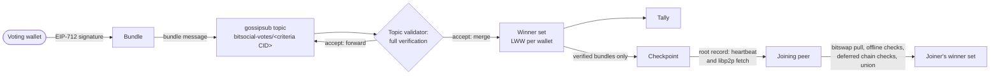

## Abstract

Pubsub voting lets the holders of an on-chain asset rank communities with no server and no tally
authority. A **contest** is defined by a **criteria document**; the CID of its canonical DAG-CBOR
encoding names the contest's gossipsub topic, so every peer on a topic runs identical rules. A voter's
wallet signs a **bundle**, its complete choice for one contest, as EIP-712 typed data that binds the
contest, the chosen communities, and a bucketized block number; the recovered signer is the voter.
Peers verify every bundle (signature, criteria constraints, an on-chain eligibility gate, and
community-name claims) before forwarding it, merge valid bundles into a last-write-wins set keyed by
wallet, and compute a deterministic tally. A bundle expires a fixed number of block buckets after it
was signed unless the voter's client signs a fresh one. Joining peers learn the current state by
fetching small root records and pulling deterministic checkpoints, and take the union of everything
they receive. This BSIP specifies what independent implementations must agree on to compute the same
tally from the same messages, as implemented by `@bitsocial/pubsub-voting`.

## Motivation

5chan's [competitive directory system](https://github.com/bitsocialnet/5chan/blob/master/README.md#competitive-directory-system)
lets many communities compete for each directory slot, and only the winner of a slot is listed on the
homepage. Today the winners are chosen by hand, through pull requests to
the directory files in
[`5chan-directories/`](https://github.com/bitsocialnet/lists/tree/master/5chan-directories).
Whoever merges those pull requests decides what every 5chan client shows, which is the kind of central
control the protocol exists to remove. Directory slots in general ([BSIP-19](./bsip-19.md)) and lists
such as a voted default-communities list
([pkc-js issue #25](https://github.com/pkcprotocol/pkc-js/issues/25)) have the same need.

Replacing the maintainer with a vote needs four things. Votes must cost nothing to cast, so they
cannot be transactions. No single peer may be able to drop or forge a vote. Eligibility must rest on a
scarce asset, or anyone can mint identities and stuff the ballot. And independent clients must agree
byte for byte on what the contest is, which bundles are valid, how they merge, and how they rank;
otherwise two clients on the same topic show different winners. This BSIP is that shared definition.

## Specification

The key words "MUST", "MUST NOT", "REQUIRED", "SHALL", "SHALL NOT", "SHOULD", "SHOULD NOT",
"RECOMMENDED", "NOT RECOMMENDED", "MAY", and "OPTIONAL" in this document are to be interpreted as
described in [RFC 2119](https://www.rfc-editor.org/rfc/rfc2119) and
[RFC 8174](https://www.rfc-editor.org/rfc/rfc8174).

### Terminology

- **Contest**: one ranking decision, for example which community holds one directory slot.
- **Criteria document**: the JSON-shaped object that defines a contest
  ([Criteria documents](#criteria-documents)).
- **Contest chain**: the EVM chain named by the document's `bucketChainId`. Every block number in a
  contest is a block of this chain.
- **Voting wallet**: the secp256k1 account that signs bundles. Its address is the voter's only
  identity.
- **Bundle**: one wallet's signed choices for one contest at one block number ([Bundles](#bundles)).
- **Bucket** and **sample block**: a fixed-size range of contest-chain blocks and its first block
  ([Buckets, expiry, and republishing](#buckets-expiry-and-republishing)).
- **Verifier**: any peer that checks bundles. **Seeder**: a long-running peer that joins contests to
  serve them. A seeder has no authority beyond any other peer.
- **Winner set**: the latest admitted bundle of each wallet ([Winner set](#winner-set)).
- **Checkpoint** and **root record**: a deterministic snapshot of a winner set and the small
  advertisement that names it ([Checkpoints](#checkpoints), [Root records](#root-records)).

These votes are unrelated to the comment votes of [BSIP-6](./bsip-6.md).

### Overview



Live bundles travel inside gossipsub messages and are fully verified before any peer forwards them.
State that a peer missed travels as checkpoints: a peer advertises the CID of its current checkpoint,
and a peer whose own CID differs pulls the checkpoint and merges it.

### Encoding

- **DAG-CBOR** means the canonical encoding of the
  [IPLD DAG-CBOR codec](https://ipld.io/specs/codecs/dag-cbor/spec/): map keys sorted by encoded
  length and then bytewise, integers and lengths in their shortest form, no indefinite lengths, no
  `undefined`, and CID links as tag 42. Every structure in this BSIP is encoded this way, and contains
  no floating-point numbers. A field documented as absent is omitted, never encoded as `null`.
- **`CID(x)`** is the CIDv1 with codec `dag-cbor` (`0x71`) and a sha2-256 multihash of the DAG-CBOR
  encoding of `x`. Its binary form is 36 bytes, `0x01 0x71 0x12 0x20` followed by the digest. Its
  string form is the default lowercase base32 multibase form (`bafyrei…`).
- Byte strings and CIDs are compared as unsigned bytes, lexicographically; a strict prefix sorts
  first.
- Publishers MUST encode canonically. Receivers decode with the DAG-CBOR codec's strict rules
  (shortest-form integers, no indefinite lengths, no duplicate map keys); the reference decoder does
  not check map key order. A bundle's CID is always the hash of the bytes as received
  ([Topic validator](#topic-validator)).

### Criteria documents

A criteria document is a map with exactly these fields; any other top-level field makes it invalid.

| Field | Type | Meaning |
| --- | --- | --- |
| `name` | string, non-empty | Human-readable label. |
| `contestId` | string, non-empty | The slot the contest decides, for example a directory code. |
| `voteSchema` | `{ min, max }`, integers | Allowed range of every `vote` value. No other keys. |
| `maxVotesPerAddress` | positive integer | Maximum number of vote entries in one bundle. |
| `bucketChainId` | positive integer | EVM chain id of the contest chain. |
| `blocksPerBucket` | positive integer | Bucket size, in contest-chain blocks. |
| `voteExpiryBuckets` | positive integer | How many buckets a bundle stays live ([Buckets, expiry, and republishing](#buckets-expiry-and-republishing)). |
| `gate` | gate node | Which wallets may vote ([The gate tree](#the-gate-tree)). |
| `weight` | rule reference | How much an admitted wallet's vote counts ([Rules](#rules)). |
| `requires` | `{ rules }` | `rules` is a non-empty array of non-empty strings: the rule types a client must implement. No other keys. |

Every field takes part in the encoding, so changing any value, including `name` and `contestId`,
defines a different contest. `contestId` is not a lookup key: two documents that share a `contestId`
but differ in any byte are two contests. A document carries no RPC endpoints or other client settings;
each client chooses its own gateway for the contest chain.

A **rule reference** is a map with a non-empty string `type` naming a rule, plus that rule's options.
Keys the rule does not define are allowed and remain part of the document's bytes.

Example (the reference implementation's test fixture, used in [Test vectors](#test-vectors)):

```json
{
  "name": "/biz/ - Business & Finance",
  "contestId": "biz",
  "voteSchema": { "min": 1, "max": 1 },
  "maxVotesPerAddress": 1,
  "bucketChainId": 8453,
  "blocksPerBucket": 43200,
  "voteExpiryBuckets": 30,
  "gate": { "rule": { "type": "erc5192-min-balance", "contract": "0x13d41d6B8EA5C86096bb7a94C3557FCF184491b9", "min": 1 } },
  "weight": { "type": "constant", "value": 1 },
  "requires": { "rules": ["erc5192-min-balance", "constant"] }
}
```

An application that runs many contests MAY author them as one manifest of shared defaults plus one
entry per contest, deriving each document as the shallow merge `{ ...defaults, ...entry }`, as 5chan's
[`5chan-directory-criteria.jsonc`](https://github.com/bitsocialnet/lists/blob/master/5chan-directory-criteria.jsonc)
does. The manifest is authoring convenience. Only the derived documents are shared, and two clients
are in the same contest only if their documents are byte-identical.

#### The gate tree

A gate node is one of:

- a **leaf** `{ "rule": <rule reference> }`;
- `{ "all": [<node>, <node>, …] }`, which admits a wallet when every child admits it;
- `{ "any": [<node>, <node>, …] }`, which admits a wallet when at least one child admits it.

Each node has exactly one key. The topic is derived from the document's bytes, so a spelling that
means the same as a shorter one would split one contest across two topics. A gate is therefore invalid
if:

- a branch has fewer than two children;
- two children of the same branch have identical DAG-CBOR encodings (the same leaf MAY appear in
  different branches, which is how "any two of A, B, C" is written:
  `{ "any": [{ "all": [A, B] }, { "all": [A, C] }, { "all": [B, C] }] }`);
- an `all` is a direct child of an `all`, or an `any` a direct child of an `any`;
- the tree is deeper than 4 (a leaf alone has depth 1) or has more than 8 leaves.

A verifier SHOULD check depth and node count (at most 16 nodes) with an iterative walk before any
recursive parsing, since a criteria document is untrusted input. Child order is significant: it is
part of the bytes and is the order in which [Folding the gate](#folding-the-gate) evaluates children.

#### Validation and recusal

A client MUST validate a document completely before deriving its topic, and validation never rewrites
it: option defaults a rule applies are not written back, and an invalid document is rejected, not
normalized. A client MUST NOT join, publish to, or display a tally for a contest unless it implements
every rule type named by a gate leaf, by `weight`, and in `requires.rules`, every leaf's and the
weight's options are valid for their rule, and it has a chain client for `bucketChainId`. A client
that cannot satisfy this recuses itself from the contest instead of counting it with different rules.

### Topic

The gossipsub topic of a contest is the string `bitsocial-votes/` followed by the string form of
`CID(criteria)`. The binary form of `CID(criteria)` is the `criteria` field of every signed ballot
([Signing](#signing)). The topic also prefixes the contest's root-record fetch key
([Fetch protocol](#fetch-protocol)), and `CID(criteria)` is the key under which seeders announce
themselves to content routers ([Cold join and divergence](#cold-join-and-divergence)).

### Rules

A **rule** answers one question about one wallet: given its options, the wallet's address, the
bundle's sample block, and, if the rule reads it, the verifier's current head of the contest chain, it
returns a **result**. A rule reads only the contest chain. A gate leaf uses the result to admit or
refuse the wallet; the `weight` rule uses it as the vote's magnitude.

A result is either a **success** with a score greater than zero, or a **failure** with a reason for the
voter and an **attributable** flag (default true). Attributable means every honest verifier computes
the same failure, so the sender can be blamed for relaying the bundle ([Dispositions](#dispositions)).
A success with a score of zero or less MUST be treated as an attributable failure. A chain read that
fails (transport error, timeout, rate limit) is not a result; it aborts the evaluation
([Validity](#validity)).

A rule's meaning is fixed by its `type`. A rule that would admit a different set of wallets MUST use
a new `type`, which, being part of the document, creates new contests. Two rules are registered in the
reference implementation and are the only ones v1 contests use.

#### `erc5192-min-balance`

Options: `contract`, a 20-byte hex EVM address; `min`, a positive integer (default 1). The contract is
expected to be a soulbound ERC-721 such as the 5chan Pass.

To evaluate wallet `W` with sample block `S` at verifier head `H`:

1. At block `H`, call `supportsInterface(0xb45a3c0e)` on `contract`
   ([ERC-165](https://eips.ethereum.org/EIPS/eip-165), with the
   [ERC-5192](https://eips.ethereum.org/EIPS/eip-5192) interface id). A call that returns false,
   reverts, or returns no data means the contract does not declare ERC-5192, and every wallet scores 0
   at that block. Otherwise call `balanceOf(W)` at block `H`. The score at `H` is the balance if it is
   at least `min`, else 0.
2. If the score at `H` is positive, the result is a success with that score.
3. Otherwise repeat step 1 at block `S`. If that score is positive, the result is a success with it.
4. Otherwise the result is a failure, not attributable, whose reason says whether the contract does
   not declare ERC-5192, the wallet holds none, or it holds fewer than `min`, as found at `S`.

Every read is pinned to an explicit block number. A verifier needs a gateway that serves state at least
`voteExpiryBuckets × blocksPerBucket` blocks behind its head, because step 3 reads at the sample block
of any live bundle. Verifiers SHOULD memoize results; the reference implementation keys head reads by
30-block windows of the head and sample-block reads by the block, which only changes how long a stale
negative can persist locally.

#### `constant`

Options: `value`, a positive integer (default 1). Every wallet scores `value`. It reads no chain state.
As `weight` with `value: 1` it means one vote per eligible wallet.

#### Folding the gate

Leaves are evaluated for a wallet and combined bottom-up. A leaf admits when its result is a success.
An `all` refuses at its first refusing child, evaluating children in document order, and admits when
every child admits; an `any` admits at its first admitting child and refuses when every child refuses.
Children after the deciding one are not evaluated. Leaves whose rule references encode identically are
evaluated once per wallet.

A refusal is attributable when: for a leaf, its result is attributable; for an `all`, the refusing
child is attributable; for an `any`, every child is attributable. If any evaluated leaf's read fails,
the gate has no outcome. The gate's own score is not used for anything; magnitude comes from `weight`.

### Bundles

A bundle in its logical form:

```jsonc
{
  "address": "0x70997970c51812dc3a010c7d01b50e0d17dc79c8",
  "votes": [
    { "community": { "name": "memes.bso", "publicKey": "12D3KooWEyoppNCUx8Yx66oV9fVnrJmG92pTuY6zbLDaz8T5XCiL" }, "vote": 1 }
  ],
  "blockNumber": 30628800,
  "signature": { "signature": "0x…", "type": "eip712" }
}
```

- `address`: the voting wallet, 20 bytes. It MUST equal the address recovered from `signature`.
- `votes`: an array, possibly empty, of vote entries:
  - `community.publicKey`: the community's key address ([BSIP-10](./bsip-10.md#key-addresses)), in
    base58btc without a multibase prefix. A verifier rejects a value that does not decode to a valid
    multihash. This is the community's identity in the contest.
  - `community.name`: OPTIONAL. The community's name ([BSIP-10](./bsip-10.md#names)), a claim checked
    as in [Community names](#community-names). When present it MUST be 1 to 253 characters with at
    least two `.`-separated labels, each non-empty and free of whitespace. When the vote carries no
    name the key is omitted; an empty string is invalid.
  - `vote`: an integer.

  The `publicKey`s of one bundle MUST be pairwise distinct. An empty `votes` array is a **withdrawal**:
  it states that the wallet votes for nothing.
- `blockNumber`: a non-negative integer no greater than 2^53 − 1, a contest-chain block number.
- `signature`: `signature` is the 65-byte EIP-712 signature, and `type` MUST be `"eip712"`.

A bundle names no contest: the contest is the topic it travels on, and the signature binds it.

#### Signing

The voting wallet signs [EIP-712](https://eips.ethereum.org/EIPS/eip-712) typed data:

```text
domain:      { name: "bitsocial-votes", chainId: <bucketChainId> }
             (no version, verifyingContract, or salt: EIP712Domain(string name,uint256 chainId))
primaryType: Ballot
types:
  Ballot     [ criteria: bytes, votes: Vote[], blockNumber: uint256 ]
  Vote       [ community: Community, vote: int256 ]
  Community  [ name: string, publicKey: string ]
message:
  criteria    = the 36-byte binary form of CID(criteria document)
  votes       = the bundle's votes in order; name is "" when the vote carries none
  blockNumber = the bundle's blockNumber
```

The signature is 65 bytes, `r ‖ s ‖ v`, as returned by `eth_signTypedData_v4`. A verifier recovers the
signer from the typed-data digest and compares it with `address` ignoring letter case. The reference
implementation accepts `v` of 27, 28, 0, or 1, and does not require a low `s`; a malleated signature
only gives the same wallet a second bundle CID, which the [Winner set](#winner-set) collapses.

#### Block encoding

The **bundle block**, which is what travels in messages, what checkpoints inline, and what the bundle
CID hashes, is a DAG-CBOR map with crypto material as byte strings:

| Key | Value |
| --- | --- |
| `address` | byte string, 20 bytes |
| `blockNumber` | integer |
| `signature` | map: `signature` (byte string, 65 bytes), `type` (string) |
| `votes` | array of maps: `community` (map: `name` (string, omitted when absent), `publicKey` (byte string: the raw multihash the base58btc string encodes)), `vote` (integer) |

Decoding maps `address` to lowercase `0x`-hex and `publicKey` to base58btc, then applies every rule of
[Bundles](#bundles). The **bundle CID** is the CID of the block bytes. This layout is separate from
the signed typed data, so changing it changes bundle CIDs but not signatures.

### Buckets, expiry, and republishing

- `bucket(n) = floor(n / blocksPerBucket)` and `sampleBlock(b) = b × blocksPerBucket`.
- A bundle's **sample block** is `sampleBlock(bucket(blockNumber))`. It is the pinned block rules are
  handed.
- A verifier's **current bucket** is `bucket(H)` for its current contest-chain head `H`.
- A publisher sets `blockNumber` to `sampleBlock(bucket(H))` for its own head `H`. Verifiers do not
  require `blockNumber` to be a bucket boundary.
- A bundle is **not yet evaluable** while `bucket(blockNumber)` exceeds the verifier's current bucket.
- A bundle is **expired** once the current bucket `c` satisfies `c > bucket(blockNumber) +
  voteExpiryBuckets`. Expiry is applied when the winner set is read, not when a bundle is verified.

A vote lasts only as long as a fresh bundle keeps replacing it. The reference library publishes each
bundle once and never re-signs on its own; keeping a vote alive is the voter's client's job. A client
that wants its vote to persist SHOULD publish a freshly signed bundle with the same choices at least
every `ceil(voteExpiryBuckets / 2)` buckets (the library's `republishIntervalBuckets`). Changing a vote
is publishing a bundle with other choices. Withdrawing is publishing an empty bundle; it supersedes the
earlier vote and expires strictly later than it.

### Validity

A verifier checks a bundle in this order, and the first failure decides the outcome:

1. **Decode.** The block is well formed and satisfies [Bundles](#bundles). Failure: reject.
2. **Signature.** `signature.type` is `"eip712"` and the recovered signer equals `address`. Failure:
   reject.
3. **Constraints.** If `votes` is non-empty, it has at most `maxVotesPerAddress` entries and every
   `vote` is within `voteSchema` (inclusive). An empty `votes` always passes. Failure: reject.
4. **Gate.** The gate ([Folding the gate](#folding-the-gate)) for `address` and the bundle's sample
   block admits. A refusal is a reject when attributable and an ignore otherwise. No outcome: ignore.
5. **Names.** Every carried `community.name` verifies ([Community names](#community-names)). Failure
   or no outcome: ignore.

Steps 1–3 are the **offline checks**; steps 4–5 are the **network checks**. A bundle that passes all
five is **valid**. Validity does not depend on the current bucket: an expired bundle can be valid.

#### Community names

A verifier resolves a carried name through the resolver interface of
[BSIP-10](./bsip-10.md#resolver-interface): `.bso` names as in
[BSIP-10](./bsip-10.md#resolving-bso-and-eth-names), or as in [BSIP-13](./bsip-13.md#resolving-bso-names)
once the client has activated it. It resolves at the head of the registry's chain; v1 does not pin
name reads to a block. The reference implementation asks only the first configured resolver whose
`canResolve` accepts the name.

| Resolution outcome ([BSIP-10](./bsip-10.md#verification-outcomes)) | Result |
| --- | --- |
| found, equal to `community.publicKey` | the name verifies |
| found, any other key; no record; invalid record | fails |
| unsupported (no resolver for the name) | fails |
| failed (error, timeout) | no outcome |

A client with no resolver for a TLD therefore drops every bundle claiming a name in it. Implementations
MAY cache found results for up to one hour ([BSIP-10](./bsip-10.md#caching-and-retries)) and SHOULD NOT
cache the others. A name never selects which community a vote counts for; `publicKey` does. A
publisher SHOULD resolve each name it is about to sign and refuse to publish a bundle whose name fails,
since every verifier would drop it.

#### Dispositions

| Outcome | Forwarded | Stored and counted | Sender penalized | Cached by bundle CID |
| --- | --- | --- | --- | --- |
| accept (valid) | yes | yes | no | yes |
| reject: provably invalid for every verifier | no | no | yes | yes |
| ignore: view-dependent, or no outcome | no | no | no | no |

Ignored bundles are judged again whenever they arrive again. Gossipsub gives a publisher no rejection
feedback, so a publisher learns the network's likely verdict only by running these checks on its own
bundle.

### Winner set

A peer **admits** a bundle by storing its block and adding it to the contest's set; a bundle is
**fully verified** once its network checks have also passed. The **winner** of a wallet (its lowercase
address) among a set of bundles is the one with the highest `blockNumber`; among equal block numbers,
the one with the lowest bundle CID.

- Merging is set union. A peer MUST NOT remove a valid bundle because another peer lacks it.
- The **current entries** at bucket `c` are the winner of each wallet, minus every wallet whose winner
  is expired at `c`.
- A withdrawal winner counts nothing but stays in the set and in checkpoints until it expires itself,
  so that a stale peer cannot resurrect the vote it superseded.
- When a bundle's deferred network checks fail it is evicted, and the wallet's best remaining bundle
  wins again. A peer SHOULD keep a superseded, unexpired bundle while its superseder's checks are
  pending.
- Removing superseded and expired bundles is housekeeping and does not change current entries.

### Tally

The tally of a contest is computed from the current entries at the verifier's current bucket `c`:

1. For each entry with non-empty `votes`, evaluate the `weight` rule for its address and sample block;
   the weight `w` is the score, or 0 on failure.
2. For each vote entry, add `w` to the row keyed by `community.publicKey`. The `vote` value is not a
   multiplier; under v1's `voteSchema` of `{ min: 1, max: 1 }` it is always 1.
3. Order rows by weight, highest first. If any two rows have equal weight, order all rows by weight
   and then by ascending **seed**, `sha256(H_c ‖ P)`, where `H_c` is the 32-byte hash of block
   `sampleBlock(c)` on the contest chain and `P` is the raw multihash bytes of the row's `publicKey`.

A row MAY display a name carried by one of its votes, and SHOULD show a name only once it has verified.
The converged tally counts fully verified bundles only. A client MAY render admitted bundles whose
network checks are still pending, provided it marks the affected rows as unverified; the reference
implementation reports `chainVerified` and `nameResolved` per row for this. A persistent tie re-rolls
its order at each bucket, and two verifiers on either side of a bucket boundary briefly disagree.

### Gossip transport

Votes use the same libp2p gossipsub layer as publications ([BSIP-4](./bsip-4.md#transport)), on their
own topics and with their own message format. A peer joins a contest by subscribing to its topic.

#### Messages

A message is a DAG-CBOR map with exactly one of these shapes:

- `{ "v": 1, "kind": "bundle", "bundle": <byte string: one bundle block> }`;
- `{ "v": 1, "kind": "root", "record": <root record, heartbeat form> }`
  ([Root records](#root-records)).

A bundle message MUST NOT exceed `256 + 512 × maxVotesPerAddress` bytes and a root message MUST NOT
exceed 256 bytes. A client publishes a bundle it has just signed once, as one bundle message; it MUST
NOT put more than one bundle in a message, and peers do not re-broadcast their winner set.

#### Topic validator

A subscribed peer MUST run this validator on every message of the topic before forwarding it, and
forward only on accept:

1. Longer than the larger of the two caps: reject.
2. Not a well-formed message: reject.
3. Root message: longer than 256 bytes, reject; sender over the root rate, ignore; otherwise accept and
   handle the record as in [Heartbeat](#heartbeat).
4. Bundle message: longer than the bundle cap, reject; sender over the bundle rate, ignore.
5. Compute the bundle CID from the received block bytes. Undecodable block: reject.
6. A cached verdict for that CID is returned as is.
7. Not yet evaluable: ignore.
8. The peer has already accepted a bundle with the same wallet, the same bucket, and identical
   DAG-CBOR-encoded `votes`: ignore. A same-choice re-sign within a bucket carries nothing new.
9. Run [Validity](#validity), and cache an accept or reject by bundle CID.
10. On accept, store the received bytes unchanged, admit the bundle as fully verified, and accept.

Validation that has not finished within 10 seconds yields ignore. A reject lowers the sender's
gossipsub score. Steps 3, 4, and 8 are local anti-amplification policy; the rates the reference
implementation applies per sending peer are 4 root messages per 60 seconds and 256 bundle messages per
10 seconds.

### Checkpoints

A peer's **checkpoint** contains, for each wallet, the winner among its fully verified bundles, minus
wallets whose winner is expired at the peer's current bucket. A peer MUST NOT serve a bundle in a
checkpoint before its network checks have passed. It is encoded as:

1. Sort the bundles by `address` bytes, ascending.
2. Pack them in order into chunks: add each bundle to the current chunk unless the chunk is non-empty
   and the sum of its bundles' block lengths plus this bundle's block length would exceed 1,048,576
   bytes, in which case start a new chunk.
3. Each **chunk block** is the DAG-CBOR array of its bundles, each in the map form of
   [Block encoding](#block-encoding).
4. The **root manifest** is `{ "chunks": [<CID link of each chunk block, in order>] }`. The
   **checkpoint root** is `CID(root manifest)`. An empty checkpoint is the root manifest
   `{ "chunks": [] }` alone.

Peers with the same verified bundles at the same current bucket therefore produce the same root. A peer encodes its checkpoint
when asked, reuses the encoding until its set or current bucket changes, and stores the blocks where
bitswap can serve them. A decoded checkpoint bundle's CID is the CID of its block re-encoded on its
own.

### Root records

A **root record** advertises a peer's current checkpoint:

- `version`: integer, 1.
- `root`: CID link, the checkpoint root.
- `count`: number of bundles in the checkpoint.
- `sizeBytes`: total length of all its blocks, root manifest included.

This is the **heartbeat form**. The **fetch form** adds `chunks`, the root manifest's list of chunk
CIDs, which lets a joiner skip fetching the manifest. A receiver MUST check that
`CID({ "chunks": chunks })` equals `root` before using `chunks`, and otherwise fetch the manifest.
`count` and `sizeBytes` are unverifiable hints and MUST NOT affect any verdict. A root record is
unsigned and carries no authority: every block hashes to its CID and every bundle is re-verified, so a
false record can only omit bundles or point at garbage.

#### Heartbeat

A peer publishes its root record, heartbeat form, on each joined topic at intervals of 10 minutes,
jittered uniformly by ±25%. At each tick a peer that holds bundles first refreshes its current bucket
and removes expired and superseded bundles, so a quiet peer stops advertising decayed state. It then
skips publishing when, since the previous tick, it heard a root equal to its own or already published
its record, unless that tick removed bundles. On receiving a root that differs from its own, a peer
chases it ([Cold join and divergence](#cold-join-and-divergence)) and, if it has not published since
its previous tick, publishes its own record once, so both sides learn of the difference.

#### Fetch protocol

A joined peer answers the [libp2p fetch protocol](https://github.com/libp2p/specs/tree/master/fetch)
for its contests. Keys are UTF-8 strings:

- **`<topic>/root`**: the value is that contest's root record in fetch form, DAG-CBOR encoded. A peer
  not joined to the contest answers NOT_FOUND.
- **`bitsocial-votes/roots`**: the value is a DAG-CBOR map from topic to root record (fetch form) for
  the contests the peer has joined. An entry MAY add `chunkBlocks`, an array of byte strings holding
  all of that checkpoint's chunk blocks in `chunks` order. A peer that has joined no contest answers an
  empty map. The reference responder includes at most 512 contests and inlines at most 524,288 bytes of
  blocks per answer, so an answer may be incomplete.

A requester that uses the bulk key MUST hash every inlined block and discard any that does not match
the CID at the same position in `chunks`. A topic missing from a non-empty bulk answer has no record at
that peer. A requester that gets NOT_FOUND or a protocol error for the bulk key falls back to the
per-contest key.

### Cold join and divergence

On joining a contest a peer asks other peers for their root records over the fetch protocol: a random
selection of up to 4 of the topic's current subscribers, up to 4 providers of `CID(criteria)` found
through its content routers, and, for 10 minutes after joining, each peer whose subscription to the
topic appears. It chases every root that differs from its own. Roots are combined by union. Matching
roots only save a download, and a root served by a single peer is still chased; a peer MUST NOT accept
or discard state by majority among peers.

To **chase** a root, a peer fetches the chunk blocks, or the manifest and then the chunks, by CID over
bitswap, preferring the peers that advertised that root. For each bundle in the checkpoint, in order:

1. Skip it if already admitted. Admission is what counts, not whether the block is present locally.
2. If a verdict is cached for its CID, admit it as fully verified when valid, skip it otherwise.
3. Skip it, without caching, if it is not yet evaluable.
4. Run the offline checks. A failing bundle is discarded and its reject cached.
5. Otherwise admit it provisionally and run its network checks in the background. A verdict evicts
   it or makes it fully verified; a read or resolver error leaves it pending for a retry.

A peer's own newly published bundle takes the same provisional path, so its own checkpoint never
serves a bundle it has not verified. A seeder SHOULD keep its last fully verified checkpoint across
restarts and reload it through the same steps, so it can serve its state when no other peer is online.

Seeders MAY announce provider records for each joined contest's `CID(criteria)`, checkpoint root, and
chunk CIDs to [Delegated Routing V1](https://specs.ipfs.tech/routing/http-routing-v1/) HTTP routers,
signed as in [IPIP-0526](https://github.com/ipfs/specs/pull/526). A provider of `CID(criteria)` asserts
only that it serves the contest; it gains no authority.

### Test vectors

All vectors are pinned by the reference implementation's tests except the topic, which is computed
from the fixture document above with the same encoders.

| Vector | Value |
| --- | --- |
| Topic of the example document | `bitsocial-votes/bafyreid2bskh6wyjbc2j4lzqwkbr4sksak5opd4upk2vlsjv2aetijc74e` |
| Its `CID(criteria)`, binary | `0x017112207a0c947f5b0908b49e2f30b2831e495202bae78f947ab555c935d00934245fe1` |

**EIP-712.** `criteria` = `0x0171122069ed193edc1ad0d931d7c6ceafeb8ba40ff1ca1a65cb0a6493e04c96483320c1`,
`chainId` = 8453, one vote `{ community: { name: "", publicKey:
"12D3KooWEyoppNCUx8Yx66oV9fVnrJmG92pTuY6zbLDaz8T5XCiL" }, vote: 1 }`, `blockNumber` = 1000. Signed with
the well-known Anvil test key `0x59c6995e998f97a5a0044966f0945389dc9e86dae88c7a8412f4603b6b78690d`:

```text
digest:    0x1b0c3e29a0bffb1305d7dc278707165ea5bbf8004b65b24738256a5544facc7a
signature: 0x67813a39ba6e600b0370934a6cc8958c5d54b2f1bdbaa5c64457262133d41e16
             3d045c635cc1ce1648421452b7a6075c4c3329205b79988c472a2e28a0bc7b5b1c
signer:    0x70997970C51812dc3A010C7d01b50e0d17dc79C8
```

**Bundle block.** `address` 0x1111111111111111111111111111111111111111, one vote for
`{ name: "memes.bso", publicKey: "12D3KooWEyoppNCUx8Yx66oV9fVnrJmG92pTuY6zbLDaz8T5XCiL" }` with `vote`
1, `blockNumber` 43200, and a placeholder signature of 65 `0x11` bytes, `type` `"eip712"`. Its block is
235 bytes with CID `bafyreifn55wc5oqdjhb2pmaevd45kgt3uiifwyiqv5iepru5rnmmvkx6v4`:

```text
a465766f74657381a264766f74650169636f6d6d756e697479a2646e616d6569
6d656d65732e62736f697075626c69634b657958260024080112204cb5abf6ad
79fbf5abbccafcc2a5ee33fe052df4ae72a652b7fea3bf9e5c78596761646472
657373541111111111111111111111111111111111111111697369676e617475
7265a2647479706566656970373132697369676e617475726558411111111111
1111111111111111111111111111111111111111111111111111111111111111
111111111111111111111111111111111111111111111111111111116b626c6f
636b4e756d62657219a8c0
```

**Messages, checkpoints, and records.** "CID of" a message or map means `CID` of its bytes.

| Input | CID |
| --- | --- |
| Bundle message carrying the bundle block above | `bafyreie4xh3uhrtxt4tsztnyw7mjyyfb6f2kbjafnlj7urflreofxzq6nq` |
| Root message, record `{ version: 1, root: bafyreifn55wc5oqdjhb2pmaevd45kgt3uiifwyiqv5iepru5rnmmvkx6v4, count: 2, sizeBytes: 470 }` | `bafyreih6zv4lx4oalkwaraejnu3ehlhhquvthr4vmxgklohpjzfmw62mby` |
| Checkpoint root of `C` (below) | `bafyreigz22r5ujmwkzdopj5b4yl55plabqbrq3hf3gvv4b6ekfbf2xxfd4` |
| Checkpoint root of `C` with a 1-byte chunk ceiling (one bundle per chunk) | `bafyreicqqw4tj3zgvvwllr6xjnopk47cefmnulm6ge6f7wmhm6mgmpckom` |
| Empty checkpoint root | `bafyreie3lvfqun6g4c6hs7yimoklt4hpawpxc7dr6rrduneuidifcrxhum` |
| Bulk answer `{ "bitsocial-votes/biz": { version: 1, root: bafyreifn55…kx6v4, chunks: [bafyreifn55…kx6v4], count: 2, sizeBytes: 470 }, "bitsocial-votes/pol": { version: 1, root: bafyreigz22…xxfd4, chunks: [], count: 0, sizeBytes: 0 } }` | `bafyreidsxpchf5kl5g7xp7lh5t523siaox5qazwmme5tb4pfave3isfrkm` |

`C` is two bundles with the placeholder signature above: address `0x…0002` voting for
`12Czge2qhmFg7TPsvfRDyZiWbwho51g5fgqc6LoVD6nTUWbodZXw` at `blockNumber` 20, and address `0x…0001`
voting for `12D3KooWEyoppNCUx8Yx66oV9fVnrJmG92pTuY6zbLDaz8T5XCiL` at `blockNumber` 10, neither with a
name, both with `vote` 1. Input order does not affect the root.

### Constants

The prefixes, version numbers, message caps, name length, gate limits, and chunk ceiling above change
bytes or verdicts, and every implementation MUST use them as given. The other numbers (heartbeat
interval, rates, deadlines, fan-out, cache ages, bulk limits, republish cadence) are local policy:
changing them changes no bytes and no converged tally. The reference implementation also retries a
failed root fetch for up to 30 s with jittered backoff from 400 ms to 4 s, keeps at most 24 concurrent
fetch streams per peer, gives each chase 30 s and runs at most 2 at once, re-examines an
unattributable gate refusal on the deferred path every 10 s for 120 s before evicting the bundle,
retries deferred-check read errors with backoff from 2 s to 60 s, and bounds its verdict cache and
re-sign filter to 4,096 entries each.

### Implementation status

Everything above is implemented in `@bitsocial/pubsub-voting` 0.7.11. Its consumers are 5chan, whose
directory contests are in a test deployment, and bitsocial-seeder. 5chan's manifest uses a
single-leaf `erc5192-min-balance` gate on Base Sepolia (chain 84532) with 1,800-block buckets and a
720-bucket expiry, about one hour and thirty days. Composite gates and host-registered rule types are
implemented but used by no published contest. The bulk fetch key is implemented in code but not yet
described in the repository's design document. The following are designed or acknowledged but not
shipped:

| Item | State |
| --- | --- |
| `erc721-min-balance` (no lock assertion) | in the code, unregistered |
| `erc20-balance` gate or weight | in the code, unregistered; needs a hold-duration guard and a tally bound |
| Additive weight over several rules | designed |
| Gate rules reading a second chain | open question |
| Name resolution pinned to a block | resolver API ready; block selection open |
| Contests without a chain | requirements written down, not designed |
| Checkpoints keyed by address (HAMT) for single-wallet lookups | deferred |
| Penalizing peers that relay bundles which never become valid | deferred |
| Criteria free of block buckets; gates without a chain, such as allowlists | acknowledged for a future major revision |

## Rationale

- **Settings live in the topic.** Deriving the topic from the document's bytes means joining a topic is
  proof of running the same rules, with no negotiation and nobody to trust. Any change, including a new
  rule, forks to a new topic, and old clients recuse rather than miscount. The cost is that bytes, not
  meaning, define a contest, which is why the gate schema rejects redundant spellings and why
  validation never normalizes.
- **Category.** This is Application, not Appchain. Voting is off-chain curation that clients agree on;
  it reads on-chain balances as a gate but defines no contract, token, or on-chain standard.
- **Off-chain, wallet-signed bundles.** A vote is an EIP-712 signature, so casting costs no gas. The
  wallet that holds the gating asset signs directly, so there is no author key and no binding between
  keys to forge or keep current. Binding `CID(criteria)` and `bucketChainId` stops replay onto another
  contest, app, or chain.
- **One bundle per wallet, last write wins.** Keying by wallet makes a flood of valid bundles from one
  wallet worth exactly one vote, and union-only merging means a peer can omit a vote but never subtract
  one an honest peer serves. The CID tiebreak is grindable through signature nonces, but it only orders
  one wallet's own bundles, so grinding gains nothing.
- **Approval, upvote only.** Downvotes turn a contest into a cheap weapon against competitors. A wallet
  supports up to `maxVotesPerAddress` distinct communities, each counted at full weight; distinctness is
  what stops one community being listed N times. `vote` stays a signed integer so a future document can
  widen the range without a new signing layout.
- **A soulbound gate.** A bundle is verified once and then stays live for the expiry window, so a
  transferable asset walked through N wallets inside that window backs N concurrent votes, each
  individually valid. `erc5192-min-balance` refuses contracts that do not declare ERC-5192, which is
  why the plain ERC-721 rule is not registered. The declaration does not prove each token is locked;
  the deployed Pass is permanently locked, and it should also be unburnable and non-reissuable, which no
  read can check.
- **Head first, pinned fallback, never blamed.** Reading at the verifier's head lets a newly minted Pass
  vote in the same block; a soulbound holding cannot move, so lagging verifiers are only late, never in
  lasting disagreement. ERC-5192 does not forbid burning, so the fallback to the bundle's own sample
  block keeps a burn from retroactively invalidating votes cast while the Pass was held. Because peers'
  heads differ, a refusal is never provably the sender's fault, so the rule marks every failure
  unattributable. The price is that ineligible floods cost the sender no peer score; the other bounds
  (size caps, signature check, caches, rate limits) remain.
- **Reject versus ignore.** A reject penalizes the sender and is cached, so it is reserved for verdicts
  every honest verifier reaches from the bytes and pinned history. Anything that depends on a
  verifier's head, clock, or name records is ignored: dropped without penalty and judged again later.
- **Verify before forwarding, bundles inline.** Carrying the bundle in the message lets a verifier
  decide from the bytes, with no fetch toward a publisher that may be offline or behind NAT, and
  checking fully before forwarding means an invalid bundle never crosses an honest hop. The cost is a
  chain read per new wallet at every forwarding peer, bounded by caches.
- **Buckets.** One sample block per bucket gives every verifier the same pinned block to fall back to,
  makes re-sign floods within a bucket duplicates, and keeps the fallback read past reorg depth.
  Expiry replaces deletion, which a grow-only union cannot express.
- **Republishing belongs to the client.** A library running on a host's shared node would otherwise
  re-sign on a timer the host cannot see and keep a wallet key hot indefinitely; the client knows
  whether its user still wants the vote.
- **Deterministic checkpoints, union not quorum.** Sorting, fixed chunking, and canonical encoding let
  peers that agree produce the same root, so a joiner downloads once. Divergent roots are unioned
  because trust is per bundle; a quorum rule would hand a colluding majority of seeders the power to
  hide votes. There is no Merkle clock: it would detect truncation of already-linked history but not
  omission of an unlinked vote, which the multi-peer union defends against anyway.
- **Small, unauthenticated root records.** A constant-size heartbeat cannot be used for amplification,
  and a record anyone could rely on would be the oracle the design avoids. The bulk key exists because,
  for a 63-contest directory, one fetch round trip per contest dominated cold-start time.
- **A rolling tie seed.** Any tiebreak known when a community is created is grindable, since key
  generation is free; a future bucket block hash is not. A bundle CID will not do either: its signer
  can re-roll it, which is harmless inside one wallet's LWW tiebreak but would let a voter decide
  between communities.
- **No criteria knob for message size or rate.** The size cap is derived from `maxVotesPerAddress` so it
  cannot contradict it. A per-wallet rate is a property of the messages a peer happened to see, so it
  can only be a local ignore, never part of the document.

Open questions:

- **Pinned name resolution.** Names resolve at head, so verifiers can disagree while a name's record
  changes, until clients re-sign. Pinning needs a canonical per-bucket block on the registry's chain
  (Ethereum for `.bso`), which differs from the contest chain.
- **Rules on a second chain.** A rule is handed a contest-chain sample block, meaningless elsewhere.
  Candidates: head only (unattributable failures, the current favorite), mapping the bucket timestamp
  to the nearest block, or per-chain buckets in the document. The choice also decides the tie seed
  chain and pinned name resolution.
- **Balance-derived weight.** `erc20-balance` needs a cheap upper bound per unverified vote for lazy
  tallying, and a hold-duration guard (holding `min` at the sample block and one expiry window earlier)
  because a fungible balance cannot be soulbound.
- **Contests without a chain.** The EIP-712 `chainId`, the tie seed, and the sample block would all
  need new definitions.
- **Received-byte canonicality.** The reference decoder accepts a bundle whose map keys are out of
  order and hashes it as received, while a strict decoder would reject it; the two would count
  different sets. A later revision should require one behavior.
- **`vote` magnitude.** The tally ignores `vote`; a document allowing values other than 1 has no
  defined meaning for them yet.
- **Alignment with BSIP-10.** The bundle schema does not apply BSIP-10's ban on uppercase letters in
  names, accepts any multihash as `publicKey` rather than only Ed25519 key addresses, and consults only
  the first matching resolver instead of each in turn.
- **Late peer scoring.** Restoring a penalty for floods of never-valid bundles needs a per-peer record
  judged after the fact and fed to gossipsub's application-specific score, which the host configures.

## Backwards Compatibility

Pubsub voting is new and changes no existing record or message. Within it:

- Any change to a criteria document is a new contest on a new topic. Votes are not migrated; old topics
  drain as their bundles expire. A change that introduces a rule type must ship in this order: release
  implementations of the rule, upgrade clients and seeders, then publish the new documents. In the other
  order, clients that have not upgraded recuse from every new contest.
- The criteria schema is strict, so documents in pre-release shapes (a `rule` field instead of `gate`,
  a `requires.chains` map, or `rpcUrls`) fail validation instead of silently deriving a different topic.
- The signing layout, bundle block, message, root record, and checkpoint layouts are pinned by the
  [Test vectors](#test-vectors). Changing any of them is a breaking change; the EIP-712 domain has no
  version field to bump.
- The bulk fetch key is additive. A peer that does not serve it answers NOT_FOUND or a protocol error,
  and requesters fall back to the per-contest key.

## Reference Implementation

[`@bitsocial/pubsub-voting`](https://github.com/bitsocialnet/pubsub-voting) (TypeScript, version
0.7.11 at the time of writing) runs on a host's existing libp2p/Helia node, which must provide
gossipsub, the libp2p fetch service, and a blockstore. With pkc-js that node is
`pkc.clients.libp2pJsClients[key].heliaNode`. Relevant modules: `src/schema/` (criteria, gate tree,
bundles), `src/topic.ts`, `src/signer/eip712.ts`, `src/crdt/codec.ts` and `src/crdt/crdt.ts` (block
encoding, winner set), `src/verify/` (validity pipeline, deferred checks), `src/rules/`
(`erc5192-min-balance`, `constant`, gate fold), `src/tally/tally.ts`, `src/transport/` (messages, topic
validator, chase, provider announcements), `src/checkpoint/codec.ts`, and `src/client/voter.ts`
(heartbeat, fetch responder, cold join). Its `DESIGN.md` records the reasoning behind each choice.

## Security Considerations

- **Sybil resistance rests on the asset.** One eligible wallet is one vote only if the gating token
  cannot move. A transferable gate, or an issuer able to burn and re-mint to a fresh wallet, multiplies
  votes inside each expiry window without producing any individually invalid bundle. Contest authors
  SHOULD point `erc5192-min-balance` only at a contract whose tokens are permanently locked,
  unburnable, and not reissuable.
- **Buying and selling wallets.** Nothing prevents selling a wallet that holds the asset. That moves one
  vote rather than multiplying it, and is out of scope.
- **Chain gateway trust.** Verdicts depend on the client's RPC gateway. A gateway that fails is handled
  as no outcome everywhere; one that returns wrong data makes that client admit or drop the wrong
  bundles. With v1's gate it cannot cause penalties to honest relayers, since no gate failure is
  attributable, but it can distort that client's tally. Clients SHOULD use a gateway they trust, with
  archive depth of at least one expiry window.
- **Withholding and eclipse.** A peer can omit bundles from what it forwards or serves, but cannot
  remove what an honest peer serves. A client surrounded only by attacker-controlled peers sees only what
  they choose; querying several independent peers and routers is the mitigation.
- **Name re-points.** When a community name's record changes, bundles naming the old pairing fail name
  checks at verifiers that check them afresh, while verifiers that accepted them earlier keep counting
  them until they expire or are replaced. Votes that omit the name keep counting for the key they name.
  A community that migrates keys ([BSIP-10](./bsip-10.md#key-migration)) keeps old-key votes until they
  expire, so it competes under the new key only as voters re-sign.
- **Verification cost.** Each new wallet costs every forwarding peer a signature recovery and, for a
  valid signature, chain reads; minting fresh wallets and fresh peer IDs is the residual. Size caps, rate
  limits, the CID verdict cache, the re-sign filter, rule memos, a validation deadline, and bounded
  concurrency limit it. Hosts SHOULD tune gossipsub scoring (invalid-message and IP-colocation
  penalties) and run `@libp2p/gossipsub` 15.0.23 or later, which fixes CVE-2026-46679.
- **Fetch responses.** The per-contest answer is about 100 bytes plus the chunk list, but the bulk
  answer can carry up to 524,288 bytes of inlined blocks for a few bytes of request. It travels over a
  connection the requester opened, so it cannot be reflected at a third party, but responders bear the
  cost; the reference responder applies no per-peer rate limit to fetch requests, and responders SHOULD
  add one.
- **Root-record sprays.** Records are hints. Chases are deduplicated by root, capped in concurrency, and
  bounded by a deadline, and the heartbeat is rate-limited per peer, so a stream of false roots costs
  bounded work and never changes state.
- **Checkpoint poisoning.** A checkpoint can contain bundles from ineligible wallets. They pass offline
  checks, count provisionally until their network checks fail, are never re-served by the receiving
  peer, and are evicted. Forged bundles fail the offline checks and are never admitted.
- **Tie grinding.** The seed depends on a block hash not known when a community is created. A block
  producer of the boundary block could influence ties in that bucket; ties are rare and re-roll every
  bucket.
- **Privacy.** Every vote is public and linked to the voting wallet, and through the gating token to
  anything else that wallet did on chain. Signed bundles can be kept and replayed as evidence after
  they expire. Clients SHOULD make this clear to voters, and voters
  who need separation SHOULD vote from a wallet used for nothing else.
- **Key handling.** The voting wallet's key signs every refresh, so it is used repeatedly while a vote
  is kept alive. Its compromise lets an attacker change or withdraw that wallet's votes; there is no
  protocol revocation beyond the wallet's own security.

## Copyright

Copyright and related rights waived via [CC0](../LICENSE.md).
