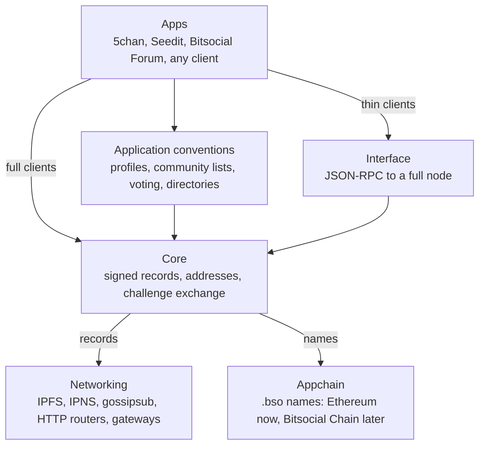
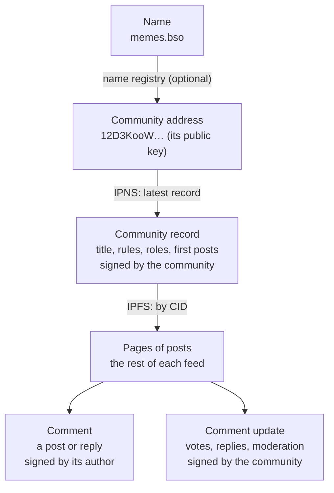
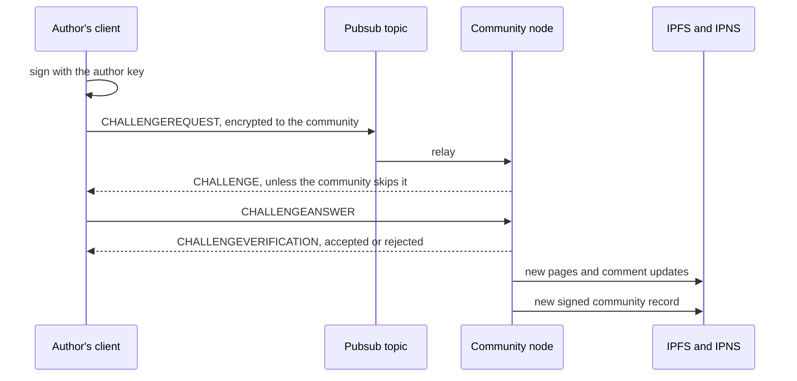

## Abstract

Bitsocial is a protocol for serverless social media. Authors and communities are key pairs.
A community is hosted by a node that holds its key, accepts publications through an anti-spam
challenge of the community's choosing, and publishes signed records to IPFS and IPNS. Readers fetch
those records from any peer or gateway and check the signatures themselves. No blockchain orders
posts or charges fees for them; a chain is used only for human-readable names.

This BSIP is a map, not a specification. It shows how the other BSIPs fit together, with diagrams of
the layers, the records, reading, and publishing. Where it disagrees with another BSIP, that BSIP is
correct and this one is updated.

## Motivation

The only overview of the design was the 2021 Plebbit whitepaper, which describes one app, a
decentralized Reddit alternative, and an early version of the protocol. Since then the protocol has
been specified piece by piece in BSIPs and now serves many clients, from imageboards and forums to
profiles and holder-voted directories. Each BSIP specifies one piece, and none shows how the pieces
fit together. This BSIP fills that gap and is kept current as BSIPs are added or changed.

## Specification

This section is descriptive. It adds no requirements.

### Design in brief

- **Keys are identities.** Every author and every community has an Ed25519 key. Its **key address**
  is the libp2p PeerId of the public key, such as `12D3KooW…`. A name such as `memes.bso` or
  `vitalik.eth` can point at a key address ([BSIP-10](./bsip-10.md)).
- **A community is a signed, mutable record.** The node that holds a community's key publishes the
  community record under the IPNS name of that key, so the address stays the same while the content
  changes ([BSIP-3](./bsip-3.md)). An owner can keep the identity key offline and let an online key
  publish for it ([BSIP-11](./bsip-11.md)).
- **Content is immutable and addressed by hash.** Posts and replies are author-signed records stored
  on IPFS and addressed by CID ([BSIP-2](./bsip-2.md)). Mutable state, such as vote counts, replies,
  edits, and moderation flags, is kept in a separate comment update signed by the community
  ([BSIP-5](./bsip-5.md)).
- **Publishing goes through the community's own anti-spam challenge.** An author sends a signed
  publication over the community's pubsub topic, and the community answers with a challenge it
  chooses, such as a captcha, a question, a rate limit, a token gate, a payment, or no challenge at all
  ([BSIP-4](./bsip-4.md)).
- **Readers verify everything.** Records can come from the reader's own node, from peers, or from
  untrusted HTTP gateways. In every case the reader checks hashes and signatures itself
  ([BSIP-16](./bsip-16.md)).
- **No global ledger for social data.** A forum does not need a global order of posts or permanent
  copies of old ones, so posts, votes, and communities are never written to a chain. Content stays
  available while someone provides it, like a torrent.

### Layers

The BSIP categories ([BSIP-1](./bsip-1.md#bsip-types)) follow the protocol's layers. Apps are built on
the core directly or through a full node's RPC interface, the core moves its records over the
networking layer, and names resolve through the appchain layer.

| Layer | Covers | BSIPs | Who must follow it |
| --- | --- | --- | --- |
| Core | Record formats, signatures, addresses, the challenge exchange | [2](./bsip-2.md)–[12](./bsip-12.md) | Every client and node |
| Networking | Finding peers and fetching records | [16](./bsip-16.md) | Programs on the peer-to-peer network |
| Interface | JSON-RPC between a client and a full node | [17](./bsip-17.md) | Programs that use the RPC |
| Appchain | `.bso` names, and later the token and tipping | [13](./bsip-13.md) | Programs that resolve or register `.bso` names |
| Application | Profiles, community lists, holder voting, directories | [14](./bsip-14.md), [15](./bsip-15.md), [18](./bsip-18.md), [19](./bsip-19.md) | Apps that opt in |

Most of the core and networking layers are implemented today by
[PKC (Public Key Communities)](https://github.com/pkcprotocol/pkc-js), the library current clients
use. PKC is the building block, not the whole protocol: names, holder voting, and directories are
already outside it.

### Records

| Record | Signed by | Changes? | Addressed by | BSIP |
| --- | --- | --- | --- | --- |
| Community record | The community key, or its minter key | Republished as the community changes | IPNS name of the community key | [3](./bsip-3.md), [11](./bsip-11.md) |
| Page of comments | Not signed; each entry carries its own signatures | A new page on every rebuild | CID | [3](./bsip-3.md) |
| Comment (post or reply) | Author | Never | CID | [2](./bsip-2.md), [12](./bsip-12.md) |
| Comment update | Community | Republished as votes, replies, and moderation arrive | A path under `postUpdates` for posts; reply pages for replies | [5](./bsip-5.md) |
| Vote, comment edit | Author | — | Delivered over pubsub; reflected in the comment update | [6](./bsip-6.md), [7](./bsip-7.md) |
| Comment moderation | A moderator, admin, or owner | — | Delivered over pubsub; reflected in the comment update | [8](./bsip-8.md) |
| Community edit | An admin or owner | — | Delivered over pubsub; reflected in the community record | [9](./bsip-9.md) |
| Community list | Curator | Never; a revision is a new list | CID | [15](./bsip-15.md) |
| Name | The name's owner, on chain | When the owner changes its `bitsocial` record | `.bso` or `.eth` name | [10](./bsip-10.md), [13](./bsip-13.md) |

### Reading a community

Reading follows a chain of pointers. A name, if the reader starts from one, resolves to the
community's address. The address resolves through IPNS to the latest community record, which holds the
first page of posts and the CIDs of further pages. Each entry of a page pairs a comment with its
comment update. The reader checks every signature and hash along the way, so it does not matter which
peer or gateway served the bytes.

A reader that cannot run a peer, such as a web page, can fetch the same records through HTTP
gateways, which it treats as untrusted, or through a full node over RPC
([BSIP-16](./bsip-16.md), [BSIP-17](./bsip-17.md)).

### Publishing to a community

Every publication (comment, vote, edit, moderation, or community edit) is signed by its author and
delivered over the community's pubsub topic in the encrypted four-message challenge exchange. Once the
community accepts it, the community includes it in the records it publishes next.

The community's node must be online to accept publications. Seeders can keep its records reachable,
for example for browsers when the node is behind NAT, but cannot sign new ones. The node's latest IPNS
record stays valid for 48 hours, so a community whose node stays offline longer stops loading
([BSIP-16](./bsip-16.md)).

### Names, token, and chain

Key addresses work with no chain at all. Names are optional and make communities and authors easier
to find and able to move to a new key ([BSIP-10](./bsip-10.md#key-migration)). `.bso` names are
registered today in an ownerless registry on Ethereum mainnet ([BSIP-13](./bsip-13.md)). Bitsocial
Chain, planned as phase 3 of the Bitsocial master plan, is meant to host `.bso` names natively along
with the token and tipping, which will be specified in Appchain BSIPs. Holder voting
([BSIP-18](./bsip-18.md)) reads asset balances on chain, but its ballots travel over pubsub.

### Apps above the protocol

Application BSIPs are conventions that apps adopt when they want to interoperate:

- a **profile** is a community that only its author posts to, fed by crossposts of their comments
  ([BSIP-14](./bsip-14.md), [BSIP-12](./bsip-12.md));
- a **community list** is a curated, signed list used for default feeds and search
  ([BSIP-15](./bsip-15.md));
- a **directory**, such as `/biz/`, is a slot that communities compete for, ranked by curated lists
  today and by holder voting later ([BSIP-19](./bsip-19.md), [BSIP-18](./bsip-18.md)).

Because every app reads the same records, a community created in one app can be opened in another.
Apps differ in presentation and defaults, not in where data lives.

## Rationale

- **An Informational BSIP instead of a whitepaper.** The BSIPs are the specification. A separate
  whitepaper would restate them and drift out of date. A Living overview inside the same repository
  is reviewed alongside the BSIPs it summarizes and is updated when they change.
- **Diagrams as text.** The diagrams are Mermaid source in this file, so they change through the same
  pull requests as the prose and render in both site themes.

## Security Considerations

This BSIP adds no mechanism. The trust model it summarizes is:

- **Authors' signatures cannot be forged.** A community, gateway, or node can withhold an author's
  comment but cannot alter it or publish one in the author's name.
- **Readers trust the community operator for what the community decides.** That includes which
  publications it accepts, vote totals, ordering, and moderation. Its records are signed, so the
  operator is accountable for them, but readers cannot verify them independently. Votes are not
  published individually ([BSIP-6](./bsip-6.md)).
- **Gateways and peers are untrusted.** Readers verify every record against its hash or signature
  and never take a gateway's IPNS resolution as proof ([BSIP-16](./bsip-16.md)).
- **An RPC node sees what its client does,** but never holds the author's key
  ([BSIP-17](./bsip-17.md)).
- **Names add trust in the chain and the resolver.** A reader that resolves a name relies on its view
  of the name registry; key addresses do not ([BSIP-10](./bsip-10.md)).
- **Peers reveal network addresses.** Joining pubsub topics and providing records exposes a peer's IP
  addresses to other peers. The challenge exchange encrypts publications in transit, but the
  community node decrypts them.
- **Content is not permanent.** Records stay available only while some node provides them, and a
  community stops loading once its node has been offline longer than its IPNS record's validity.

## Copyright

Copyright and related rights waived via [CC0](../LICENSE.md).
