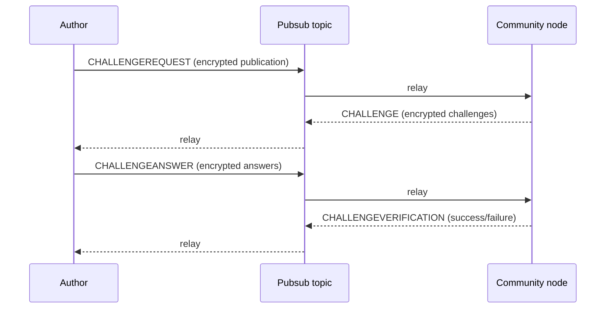

## Abstract

Publications — comments, votes, edits, moderation actions, and community edits — are delivered to a
community over a peer-to-peer pubsub network. Before a community accepts a publication, the publisher
completes an **anti-spam challenge** through an encrypted, four-message exchange: `CHALLENGEREQUEST`,
`CHALLENGE`, `CHALLENGEANSWER`, and `CHALLENGEVERIFICATION`. This BSIP defines the pubsub message
envelope, the exchange, the encryption that protects the publisher's identity and content in transit,
and the acceptance rules every publication must meet.

## Motivation

An open pubsub network has no gatekeeper, so anyone can publish to a community's topic. Without a
shared challenge protocol, communities could not defend themselves against spam, and clients could not
interoperate with each other's communities. This BSIP specifies the exchange precisely enough that any
client and any community node can complete it, regardless of which challenges a community chooses.

## Specification

The key words "MUST", "MUST NOT", "REQUIRED", "SHALL", "SHALL NOT", "SHOULD", "SHOULD NOT",
"RECOMMENDED", "NOT RECOMMENDED", "MAY", and "OPTIONAL" in this document are to be interpreted as
described in [RFC 2119](https://www.rfc-editor.org/rfc/rfc2119) and
[RFC 8174](https://www.rfc-editor.org/rfc/rfc8174).

### Transport

Publications are published over libp2p **gossipsub** pubsub, on the topic named by the community
record's `pubsubTopic` ([BSIP-3](./bsip-3.md)). A community whose record has no `pubsubTopic` accepts
no publications over pubsub, and clients MUST NOT attempt an exchange with it. All messages in the
exchange are **CBOR-encoded**. Unlike the base64 strings in IPFS records ([BSIP-2](./bsip-2.md)),
binary fields in these messages (signatures, public keys, encrypted parts, and the challenge request
id) are CBOR byte strings. Messages are encoded with the same deterministic CBOR rules used for
signing ([BSIP-2](./bsip-2.md#signatures)). Publishers MUST NOT send a message larger than 80,000
bytes, and a community MAY drop larger messages without replying.

### Message envelope

Every message in the exchange carries these fields:

- `type` — REQUIRED. One of `CHALLENGEREQUEST`, `CHALLENGE`, `CHALLENGEANSWER`, `CHALLENGEVERIFICATION`.
- `challengeRequestId` — REQUIRED. Byte string: the multihash of the PeerId of the request's
  `signature.publicKey`. For an Ed25519 key this is the identity multihash of the libp2p
  protobuf-encoded public key, `0x00 0x24 0x08 0x01 0x12 0x20` followed by the 32 key bytes. It
  identifies the exchange and MUST be the same across all four messages of one exchange.
- `signature` — REQUIRED. `{ signature, publicKey, type, signedPropertyNames }`, where `signature`
  (64 bytes) and `publicKey` (32 bytes) are byte strings and `type` is `"ed25519"`. Signing follows
  [BSIP-2, Signatures](./bsip-2.md#signatures), with the byte strings encoded as CBOR byte strings.
- `protocolVersion` — REQUIRED. String, currently `"1.0.0"`.
- `userAgent` — REQUIRED. The implementation's non-empty user-agent string.
- `timestamp` — REQUIRED. Integer Unix time in seconds.

Each message type's `signedPropertyNames` lists every field the message carries except `signature`.
A receiver MUST reject a message that:

- carries a field not listed in `signedPropertyNames`, or whose signature is invalid;
- has a `timestamp` more than five minutes before or after the receiver's clock;
- is a `CHALLENGEREQUEST` or `CHALLENGEANSWER` whose `challengeRequestId` is not derived from its own
  `signature.publicKey` as above;
- is a `CHALLENGE` or `CHALLENGEVERIFICATION` not signed by the community's encryption key
  (`encryption.publicKey`, which [BSIP-3](./bsip-3.md#encryption) pins to the record's signer).

The publisher MUST generate a **fresh keypair for each exchange** and use it for its message
signatures and `challengeRequestId`. This keypair is unrelated to the author key that signs the
publication; it exists only to correlate the four messages and to unlink the exchange from the
author's long-lived identity.

### The exchange

1. **`CHALLENGEREQUEST`** carries `encrypted`, the request payload encrypted to the community
   ([Encryption](#encryption)), and MAY carry `acceptedChallengeTypes`, a plaintext array of the
   challenge types the client can present (for example `image/png`). The decrypted payload is a JSON
   object with exactly one publication under one of these keys — `comment` ([BSIP-2](./bsip-2.md)),
   `vote` ([BSIP-6](./bsip-6.md)), `commentEdit` ([BSIP-7](./bsip-7.md)), `commentModeration`
   ([BSIP-8](./bsip-8.md)), or `communityEdit` ([BSIP-9](./bsip-9.md)) — and MAY also contain:
   - `challengeAnswers` — a non-empty array of strings answering challenges known in advance, such as
     a static `challenge` published in the community record;
   - `challengeCommentCids` — CIDs of the author's comments in other communities, used by
     `exclude.community` rules ([BSIP-3](./bsip-3.md#anti-spam-configuration)).

   A community MUST reject a request whose payload contains no publication or more than one.

2. **`CHALLENGE`** carries `encrypted`, which decrypts to `{ "challenges": [...] }`. Each challenge
   is `{ "challenge": string, "type": string, "caseInsensitive"?: boolean }`; `challenge` is the
   prompt itself, for example a base64 image when `type` is `image/png` or a question when it is
   `text/plain`.

3. **`CHALLENGEANSWER`** carries `encrypted`, which decrypts to `{ "challengeAnswers": [...] }`, a
   non-empty array of strings positionally matching the challenges.

4. **`CHALLENGEVERIFICATION`** carries `challengeSuccess` (boolean). On failure it MAY carry
   `challengeErrors`, a map from a challenge index (a decimal string) to an error message, and
   `reason`, a human-readable explanation. On success for a comment it carries `encrypted`, which
   decrypts to `{ "comment": <comment record>, "commentUpdate": <reduced comment update> }`
   ([BSIP-5](./bsip-5.md#reduced-comment-updates)), so the author learns the CID and initial state of
   the accepted comment. When the comment was held for moderator approval, the reduced update carries
   `pendingApproval: true`.

Two shortcuts are allowed:

- If the request already contains valid `challengeAnswers`, or the community's challenges need no
  interaction, the community MAY skip `CHALLENGE` and `CHALLENGEANSWER` and reply directly with
  `CHALLENGEVERIFICATION`.
- If the author is excluded from every challenge ([BSIP-3](./bsip-3.md#anti-spam-configuration)), or
  the publication is rejected outright (for example the author is banned), the community MAY reply
  directly with `CHALLENGEVERIFICATION`.

A community chooses its challenges freely — captcha, question, rate limit, token gate, payment,
allowlist, or custom code — and advertises their public shape in its record's `challenges`. A
community SHOULD wait at least ten minutes for a `CHALLENGEANSWER` before failing the exchange.

### Duplicate requests

A publisher MAY resend the same signed publication, for example after a lost verification, using a new
exchange keypair. A community identifies a publication by its signature:

- If an exchange for the same signed publication is still running, the community SHOULD wait for it to
  finish and then answer from its outcome instead of challenging again.
- If a comment, comment edit, or comment moderation was already stored, the community MUST NOT
  store it again. It SHOULD answer with a successful verification carrying the stored record, at most
  once per publication within ten minutes, and reject further repeats as duplicates.
- A community MUST reject a community edit whose signature it already accepted
  ([BSIP-9](./bsip-9.md)), and SHOULD reject a repeated vote signature ([BSIP-6](./bsip-6.md)). The
  current implementation re-applies both, so a repeated earlier vote replaces the author's current
  one and a repeated community edit can undo a later one.

### Encryption

Encrypted message parts use the `ed25519-aes-gcm` scheme. An encrypted value is
`{ "ciphertext": bytes, "iv": bytes, "tag": bytes, "type": "ed25519-aes-gcm" }`, with the binary
fields as CBOR byte strings. To encrypt a payload:

1. Determine the two keys. For `CHALLENGEREQUEST` and `CHALLENGEANSWER`, the sender is the exchange
   keypair and the recipient is the community's `encryption.publicKey`. For `CHALLENGE` and
   `CHALLENGEVERIFICATION`, the sender is the community key and the recipient is the request's
   `signature.publicKey`.
2. Convert both keys to X25519 ([RFC 7748](https://www.rfc-editor.org/rfc/rfc7748)): the sender's
   X25519 private scalar is the first 32 bytes of SHA-512 of its 32-byte Ed25519 private key, clamped
   as in [RFC 8032, section 5.1.5](https://www.rfc-editor.org/rfc/rfc8032#section-5.1.5); the
   recipient's X25519 public key is `u = (1 + y) / (1 − y) mod p`, where `y` is the Edwards
   coordinate encoded by its Ed25519 public key. Compute the 32-byte X25519 shared secret and reject
   an all-zero result. Both directions of one exchange derive the same secret.
3. Use the **first 16 bytes** of the shared secret, as is, as an **AES-128-GCM** key.
4. Serialize the payload as JSON and append a random number, between 0 and 5000, of space characters
   (U+0020) to obscure its length.
5. Encrypt the UTF-8 bytes with a random **12-byte IV** from a cryptographically secure generator and
   no additional authenticated data, producing the ciphertext and a 16-byte GCM authentication tag,
   carried separately in `ciphertext` and `tag`.

To decrypt, the receiver derives the same key from its private key and the sender's public key,
decrypts, and MUST reject the message if the authentication tag does not verify; it MUST NOT use any
output of a failed decryption. It then strips trailing spaces and parses the JSON. Test vectors are in
[`assets/bsip-4/encryption-vectors.json`](../assets/bsip-4/encryption-vectors.json) and
[`assets/bsip-4/pubsub-signature-vectors.json`](../assets/bsip-4/pubsub-signature-vectors.json).

### Publication acceptance

After decrypting a request and before or alongside running its challenges, a community MUST verify the
publication's signature with the rules of its type, and MUST reject any publication that:

- carries `communityAddress` or the legacy `subplebbitAddress`, or a field its type reserves;
- carries a string that is not well-formed Unicode, or an empty `author` object;
- has a `communityPublicKey` that is missing or not the community's identity key (the anchor, for a
  delegated community), a `communityName` that differs from the community's name, or no
  `communityName` when the community has one ([BSIP-2](./bsip-2.md#community-addressing));
- has a `timestamp` more than five minutes before or after the community's clock;
- comes from an author whose ban in this community has not expired
  ([BSIP-5](./bsip-5.md#author-community-standing));
- has an `author.name` that is not a lowercase domain name, or — when the community resolves author
  names — that does not resolve to the publication's signing key ([BSIP-10](./bsip-10.md));
- is larger than 40,000 bytes when serialized as JSON;
- fails its type-specific rules ([BSIP-2](./bsip-2.md#community-acceptance-of-comments),
  [BSIP-6](./bsip-6.md), [BSIP-7](./bsip-7.md), [BSIP-8](./bsip-8.md), [BSIP-9](./bsip-9.md)).

A publication that targets an existing comment — a reply (`parentCid`), a vote, a comment edit, or a
comment moderation (`commentCid`) — MUST also be rejected when the target does not exist in the
community or its `timestamp` is later than the publication's, or, unless it is a comment
moderation, when:

- the target or its thread's post was removed by a moderator or deleted by its author;
- the thread's post is archived;
- the thread's post is locked, unless the publication is not a vote and its author holds the `owner`,
  `admin`, or `moderator` role;
- the target is pending approval or was disapproved, unless the publication is an author edit that
  deletes it.

### Network-layer abuse handling

Peers that relay an excessive number of failed challenge attempts SHOULD be throttled or excluded from
the topic by other peers, so that the challenge layer cannot be turned into a denial-of-service vector
against the pubsub network itself.

## Rationale

- **Encrypting the publication inside the request** means network observers see that *some* peer
  published *something* to a topic, but not the content or the author's identity.
- **A fresh per-exchange keypair** unlinks the challenge handshake from the author's long-lived key,
  so completing a challenge does not deanonymize the author at the network layer.
- **Positional `challengeAnswers`** and **pre-emptive answers** keep the common, non-interactive case
  (rate limits, token gates, static passwords) to a single round trip while still supporting
  interactive captchas.
- **Signing every envelope field** prevents a relay from altering plaintext fields such as
  `challengeSuccess`, `reason`, or `acceptedChallengeTypes` in transit.
- **Answering duplicates by signature** lets a publisher safely retry over another route without the
  community storing the same publication twice.

## Backwards Compatibility

A client that implements only `comment` and `vote` remains interoperable for those types; the other
publication types are additive. The AES-GCM tag check was not enforced by every earlier
implementation; implementations MUST enforce it now. Records without `pubsubTopic` previously implied
a default topic and now mean the community accepts no pubsub publications ([BSIP-3](./bsip-3.md)).

## Security Considerations

- **Per-request keypairs are mandatory for privacy.** Reusing a keypair across exchanges links a
  publisher's actions and undermines the unlinkability the scheme is designed to provide.
- **Verify before acting.** A community MUST verify the publication signature ([BSIP-2](./bsip-2.md))
  after decryption, independently of the challenge outcome; a passed challenge proves effort, not
  authorship.
- **Authenticate the reply.** Clients MUST check that `CHALLENGE` and `CHALLENGEVERIFICATION` are
  signed by the community's key; otherwise any peer on the topic could send fake challenges or fake
  verifications.
- **Key derivation.** The AES key is the truncated raw X25519 output with no key-derivation function,
  and the community's Ed25519 key is reused for X25519. Both are known departures from common
  practice. They are safe enough for the current threat model only because every exchange uses a
  fresh publisher key and a random IV; a future version SHOULD derive the key with HKDF and domain
  separation.
- **Length and timing leakage.** Random padding obscures plaintext length, but averages over many
  messages can still reveal it, and the reference implementation draws the padding length from a
  non-cryptographic generator. Implementations SHOULD also avoid other side channels (for example
  distinctive timing) that could correlate an exchange with an author.
- **Denial of service.** Challenge verification is the network's main abuse surface; communities and
  relaying peers SHOULD rate-limit failed attempts, and clients SHOULD treat repeated failures as a
  signal to back off.
- **Replay.** `challengeRequestId`, `timestamp`, and the fresh keypair scope an exchange; the
  five-minute timestamp window and duplicate detection by publication signature bound replays.

## Copyright

Copyright and related rights waived via [CC0](../LICENSE.md).
