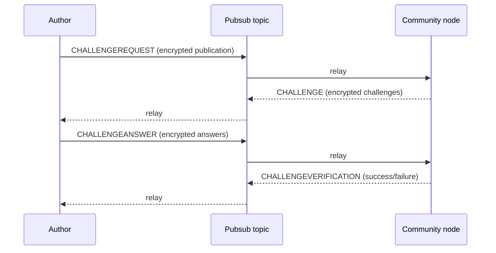

## Abstract

Publications — comments, votes, edits, and moderation actions — are delivered to a community over a
peer-to-peer pubsub network. Before a community accepts a publication, the publisher completes an
**anti-spam challenge** through an encrypted, four-message exchange: `CHALLENGEREQUEST`, `CHALLENGE`,
`CHALLENGEANSWER`, and `CHALLENGEVERIFICATION`. This BSIP defines the pubsub message envelope, the
exchange, and the encryption that protects the publisher's identity and content in transit.

## Motivation

An open pubsub network has no gatekeeper, so anyone can publish to a community's topic. Without a
shared challenge protocol, communities could not defend themselves against spam, and clients could not
interoperate with each other's communities. This BSIP specifies the exchange precisely enough that any
client and any community node can complete it, regardless of which challenge a community chooses.

## Specification

The key words "MUST", "MUST NOT", "REQUIRED", "SHOULD", "SHOULD NOT", "MAY", and "OPTIONAL" in this
document are to be interpreted as described in [RFC 2119](https://www.rfc-editor.org/rfc/rfc2119) and
[RFC 8174](https://www.rfc-editor.org/rfc/rfc8174).

### Transport

Publications are published over libp2p **gossipsub** pubsub. The topic is the community's
`pubsubTopic` ([BSIP-3](./bsip-3.md)). All pubsub messages in this exchange are **CBOR-encoded**.
Unlike the base64 string fields in IPFS records ([BSIP-2](./bsip-2.md)), binary fields in pubsub
messages (signatures, public keys, encrypted parts, and the challenge request id) are carried as CBOR
byte strings.

### Message envelope

Every message in the exchange shares a base envelope:

- `type` — REQUIRED. One of `CHALLENGEREQUEST`, `CHALLENGE`, `CHALLENGEANSWER`, `CHALLENGEVERIFICATION`.
- `challengeRequestId` — REQUIRED. The multihash (PeerId) of the request's `signature.publicKey`. It
  identifies the exchange and MUST be the same across all four messages of one exchange.
- `signature` — REQUIRED. A pubsub-message signature `{ signature, publicKey, type, signedPropertyNames }`,
  where `signature` and `publicKey` (32 bytes) are binary. Signing and verification follow the CBOR
  rules of [BSIP-2](./bsip-2.md#signatures), over binary rather than base64 encodings.
- `protocolVersion` — REQUIRED. String, currently `"1.0.0"`.
- `userAgent` — REQUIRED. The implementation's user-agent string.
- `timestamp` — REQUIRED. Integer Unix time in seconds.

The publisher MUST generate a **fresh keypair for each exchange** and use it for the message
signatures and `challengeRequestId`. This keypair is unrelated to the author keypair that signs the
publication itself; it exists only to correlate the four messages and to unlink the exchange from the
author's long-lived identity.

### The exchange

1. **`CHALLENGEREQUEST`** — The author publishes their publication, **encrypted** to the community's
   encryption public key ([BSIP-3](./bsip-3.md#encryption)). The decrypted payload contains exactly one
   publication under one of these keys — `comment`, `vote`, `commentEdit`, `commentModeration`, or
   `communityEdit` — and MAY contain `challengeAnswers` (pre-emptive answers, when the community's
   challenges are known in advance) and `challengeCommentCids` (CIDs supporting exclusion checks). The
   message MAY also carry an `acceptedChallengeTypes` list advertising which challenge types the client
   can solve.

2. **`CHALLENGE`** — The community replies with an **encrypted** list of challenges to solve. Each
   challenge has a `challenge` payload (for example a base64 captcha image or a text question), a
   `type` (for example `image/png` or `text/plain`), and an optional `caseInsensitive` flag.

3. **`CHALLENGEANSWER`** — The author replies with an **encrypted** `challengeAnswers` array of
   strings, positionally matching the challenges.

4. **`CHALLENGEVERIFICATION`** — The community replies with `challengeSuccess` (boolean). On failure it
   MAY include `challengeErrors` (a map from challenge index to an error message) and a `reason`. On
   success it MAY include an **encrypted** payload containing the resulting `comment` record
   ([BSIP-2](./bsip-2.md)) and a reduced `commentUpdate` ([BSIP-5](./bsip-5.md)), so the author learns
   the CID and initial state of their accepted publication.

Two shortcuts are allowed:

- If the author already includes valid `challengeAnswers` in the `CHALLENGEREQUEST` (or the community's
  challenges need no interaction), the community MAY skip `CHALLENGE`/`CHALLENGEANSWER` and reply
  directly with `CHALLENGEVERIFICATION`.
- If the author is excluded from challenges (for example whitelisted) or rejected outright (for example
  banned), the community MAY reply directly with `CHALLENGEVERIFICATION`.

A community MAY define its challenge policy freely — captcha, rate limit, token gate, payment,
allowlist, or custom code — and MAY exclude authors based on karma, account age, role, or an
allowlist. The public shape of that policy is advertised in the community record's `challenges`
([BSIP-3](./bsip-3.md#anti-spam-configuration)); the secret material stays with the community node.

### Encryption

Encrypted message parts use the `ed25519-aes-gcm` scheme. An encrypted value is an object
`{ ciphertext, iv, tag, type: "ed25519-aes-gcm" }` (binary fields, CBOR byte strings). The scheme:

1. The sender has an Ed25519 keypair; the recipient is identified by their Ed25519 public key (32
   bytes). For a `CHALLENGEREQUEST`/`CHALLENGEANSWER`, the recipient is the community
   (`community.encryption.publicKey`); for a `CHALLENGE`/`CHALLENGEVERIFICATION`, the recipient is the
   request keypair.
2. Both keys are converted to Montgomery form and an **X25519 ECDH shared secret** is computed. The
   shared secret is never transmitted.
3. The first **16 bytes** of the shared secret are used as an **AES-128-GCM** key.
4. The plaintext is the JSON encoding of the payload, with **random whitespace padding** (0–5000
   characters) appended to obscure its length, then encrypted with a random **12-byte IV**.
5. The output carries `ciphertext`, the `iv`, and the GCM authentication `tag` separately. Decryption
   verifies the `tag`, decrypts, and strips trailing padding whitespace.

### Network-layer abuse handling

Peers that relay an excessive number of failed challenge attempts SHOULD be throttled or excluded from
the topic by other peers, so that the challenge layer cannot be turned into a denial-of-service vector
against the pubsub network itself.

## Rationale

- **Encrypting the publication inside the request** means network observers see that *some* peer
  published *something* to a topic, but not the content or the author identity — the privacy property
  BitTorrent lacks for content.
- **A fresh per-exchange keypair** unlinks the spam-challenge handshake from the author's long-lived
  key, so completing a challenge does not deanonymize the author at the network layer.
- **Positional `challengeAnswers`** and **pre-emptive answers** keep the common, non-interactive case
  (rate limits, token gates) to a single round trip while still supporting interactive captchas.
- **CBOR with separated GCM tag** mirrors the comment signing model, giving one canonical binary
  encoding across the protocol.

## Backwards Compatibility

The encrypted `CHALLENGEREQUEST` payload carries exactly one publication under `comment`, `vote`,
`commentEdit`, `commentModeration`, or `communityEdit`. A client that implements only `comment` and
`vote` remains interoperable for those types; the other payloads are additive.

## Security Considerations

- **Per-request keypairs are mandatory for privacy.** Reusing a keypair across exchanges links a
  publisher's actions and undermines the unlinkability the scheme is designed to provide.
- **Verify before acting.** A community MUST verify the publication signature ([BSIP-2](./bsip-2.md))
  after decryption, independently of the challenge outcome; a passed challenge proves effort, not
  authorship.
- **Length and timing leakage.** Whitespace padding obscures plaintext length, but implementations
  SHOULD also avoid other side channels (for example distinctive timing) that could correlate an
  exchange with an author.
- **Denial of service.** Challenge verification is the network's main abuse surface; communities and
  relaying peers SHOULD rate-limit failed attempts, and clients SHOULD treat repeated failures as a
  signal to back off.
- **Replay.** `challengeRequestId`, `timestamp`, and the fresh keypair scope an exchange; community
  nodes SHOULD reject stale or duplicate exchanges.

## Copyright

Copyright and related rights waived via [CC0](../LICENSE.md).
